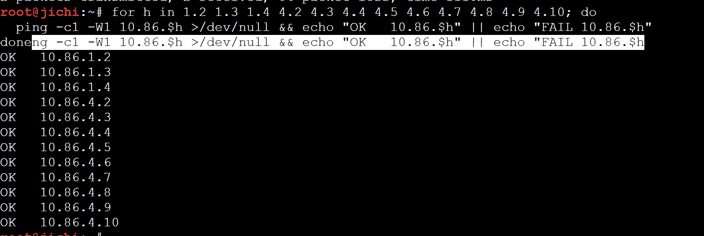
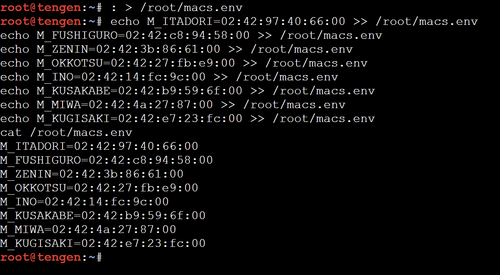
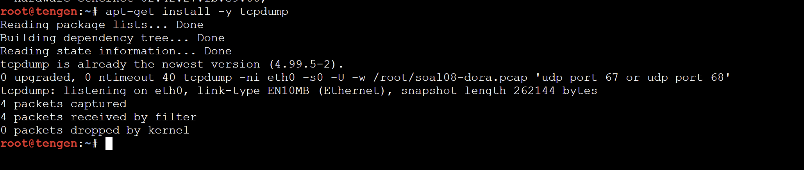

# JARKOM MODUL 3 2026 - K-45

## Anggota

| Nama                         | NRP        |
| ---------------------------- | ---------- |
| Abhista Athallah Dyfan       | 5027251006 |
| Rifqi Dwi Muslim             | 5027251077 |

---

**Daftar node:**

| Jumlah | Jenis node       | Node                                                                                        |
| ------ | ---------------- | ------------------------------------------------------------------------------------------- |
| 13     | Docker (debinet) | jichi, tengen, utahime, shoko, gojo, geto, maki, panda, nanami, todo, kirara, yaga, inumaki |
| 8      | Docker (alpinet) | itadori, fushiguro, zenin, okkotsu, ino, kusakabe, miwa, kugisaki                           |
| 10     | Ethernet switch  | Switch1 sampai Switch10                                                                     |
| 1      | NAT              | NAT1                                                                                        |


**TOPOLOGI JARINGAN:**


---

## Rancangan Pengalamatan IP

Prefix kelompok adalah **`10.86.x.x`** dengan domain **`k45.com`**. Router jichi terhubung ke empat jaringan, masing-masing satu subnet `/24`.

| Network                 | Subnet       | Gateway (jichi)  | Node                                                           |
| ----------------------- | ------------ | ---------------- | -------------------------------------------------------------- |
| Network 1 (DMZ)         | 10.86.1.0/24 | 10.86.1.1 (eth1) | utahime, shoko, gojo                                           |
| Network 2 (Divisi A)    | 10.86.2.0/24 | 10.86.2.1 (eth2) | itadori, fushiguro, zenin, okkotsu (DHCP)                      |
| Network 3 (Divisi B)    | 10.86.3.0/24 | 10.86.3.1 (eth3) | ino, kusakabe, miwa, kugisaki (DHCP)                           |
| Network 4 (Data Center) | 10.86.4.0/24 | 10.86.4.1 (eth4) | tengen, geto, maki, panda, nanami, todo, kirara, yaga, inumaki |

**Alamat IP statis node infrastruktur:**

| Node    | IP         | Gateway   | Peran                           |
| ------- | ---------- | --------- | ------------------------------- |
| jichi   | multi eth  | -         | Router utama, NAT, DHCP Relay   |
| utahime | 10.86.1.2  | 10.86.1.1 | DNS Master                      |
| shoko   | 10.86.1.3  | 10.86.1.1 | DNS Slave                       |
| gojo    | 10.86.1.4  | 10.86.1.1 | Public Reverse Proxy            |
| geto    | 10.86.4.2  | 10.86.4.1 | Internal Load Balancer          |
| maki    | 10.86.4.3  | 10.86.4.1 | Worker frontend                 |
| panda   | 10.86.4.4  | 10.86.4.1 | Worker frontend                 |
| nanami  | 10.86.4.5  | 10.86.4.1 | Worker API utama                |
| todo    | 10.86.4.6  | 10.86.4.1 | Worker API utama                |
| kirara  | 10.86.4.7  | 10.86.4.1 | Worker API cadangan             |
| yaga    | 10.86.4.8  | 10.86.4.1 | Database Master                 |
| inumaki | 10.86.4.9  | 10.86.4.1 | Database Slave                  |
| tengen  | 10.86.4.10 | 10.86.4.1 | DHCP Server                     |

Seluruh node memakai netmask `255.255.255.0`. Interface eth0 jichi memperoleh alamat `192.168.122.x` dari DHCP NAT.

**Kebijakan DHCP yang diterapkan (soal 4 sampai 6):**

| Client             | Network | Rentang / alamat            | Lease time    |
| ------------------ | ------- | --------------------------- | ------------- |
| itadori, fushiguro | 2       | 10.86.2.10 - 10.86.2.35     | 600 (default) |
| zenin, okkotsu     | 2       | 10.86.2.70 - 10.86.2.95     | 600 (default) |
| tidak dialokasikan | 2       | 10.86.2.36 - 10.86.2.69     | -             |
| ino, kusakabe      | 3       | 10.86.3.10 - 10.86.3.89     | 1800          |
| miwa               | 3       | 10.86.3.100 - 10.86.3.199   | 43200         |
| kugisaki           | 3       | 10.86.3.99 (fixed address)  | 600 (default) |

---

## Urutan Pengerjaan

1. NAT1 dan seluruh switch dijalankan lebih dulu. Switch yang belum berjalan tidak meneruskan frame.
2. Router jichi dikonfigurasi (WAN, gateway Network 1 sampai 4, forwarding, NAT) agar node lain memiliki jalur keluar untuk mengunduh paket.
3. Host infrastruktur diberi IP statis, gateway, dan resolver awal.
4. tengen memasang DHCP server, jichi memasang DHCP relay, lalu client meminta lease.
5. Kebijakan alokasi diterapkan bertahap: dua pool (soal 4), short lease, long lease, dan DNS (soal 5), lalu static lease (soal 6).
6. Validasi, packet capture, simulasi gangguan relay, dan pengujian setelah restart (soal 7 sampai 10).

---

### SOAL 1

**Diminta:** memulihkan konektivitas antarjaringan melalui jichi. Interface eth0 memperoleh WAN dari NAT, eth1 sampai eth4 menjadi gateway Network 1 sampai 4, IPv4 forwarding dan source NAT diaktifkan, host infrastruktur diberi IP statis, lalu dibuktikan setiap host dapat menjangkau gateway dan akses eksternal.

Sebelum mulai, NAT1 dan seluruh switch dipastikan sudah berjalan.

#### Konfigurasi jichi

Langkah 1, memeriksa alamat eth0. Image `debinet` sudah menjalankan `udhcpc` saat boot sehingga eth0 umumnya sudah memperoleh alamat `192.168.122.x`:

```sh
ip -br a
```

Apabila eth0 belum memiliki alamat, alamat diminta secara manual:

```sh
udhcpc -i eth0 -n -q
ip -br a
```

Langkah 2, resolver awal agar `apt` dapat mengunduh paket:

```sh
echo "nameserver 192.168.122.1" > /etc/resolv.conf
```

Langkah 3, alamat gateway untuk keempat jaringan:

```sh
ip addr replace 10.86.1.1/24 dev eth1 && ip link set eth1 up
ip addr replace 10.86.2.1/24 dev eth2 && ip link set eth2 up
ip addr replace 10.86.3.1/24 dev eth3 && ip link set eth3 up
ip addr replace 10.86.4.1/24 dev eth4 && ip link set eth4 up
```

Langkah 4, mengaktifkan IPv4 forwarding:

```sh
sysctl -w net.ipv4.ip_forward=1
```

Langkah 5, memasang iptables bila belum tersedia, lalu menambahkan aturan source NAT:

```sh
command -v iptables >/dev/null || (apt-get update && apt-get install -y iptables)
iptables -t nat -C POSTROUTING -s 10.86.0.0/16 -o eth0 -j MASQUERADE 2>/dev/null || iptables -t nat -A POSTROUTING -s 10.86.0.0/16 -o eth0 -j MASQUERADE
```

Arti aturan tersebut:

- `-t nat -A POSTROUTING` menerapkan aturan pada paket yang akan meninggalkan router.
- `-s 10.86.0.0/16` membatasi aturan pada paket dari subnet internal kelompok.
- `-o eth0` berarti paket keluar melalui interface yang terhubung ke NAT.
- `-j MASQUERADE` mengganti alamat sumber paket dengan alamat eth0 jichi.
- Bagian `-C ... ||` memeriksa aturan terlebih dahulu sehingga aturan tidak tercatat ganda apabila perintah dijalankan ulang.

Langkah 6, pemeriksaan hasil konfigurasi jichi:

```sh
ip -br a
ip route
```

#### Konfigurasi host infrastruktur

Setiap host menjalankan empat perintah yang sama dengan alamat dan gateway masing-masing.

**utahime**

```sh
ip addr replace 10.86.1.2/24 dev eth0
ip link set eth0 up
ip route replace default via 10.86.1.1
echo "nameserver 192.168.122.1" > /etc/resolv.conf
```

**shoko**

```sh
ip addr replace 10.86.1.3/24 dev eth0
ip link set eth0 up
ip route replace default via 10.86.1.1
echo "nameserver 192.168.122.1" > /etc/resolv.conf
```

**gojo**

```sh
ip addr replace 10.86.1.4/24 dev eth0
ip link set eth0 up
ip route replace default via 10.86.1.1
echo "nameserver 192.168.122.1" > /etc/resolv.conf
```

**geto**

```sh
ip addr replace 10.86.4.2/24 dev eth0
ip link set eth0 up
ip route replace default via 10.86.4.1
echo "nameserver 192.168.122.1" > /etc/resolv.conf
```

**maki**

```sh
ip addr replace 10.86.4.3/24 dev eth0
ip link set eth0 up
ip route replace default via 10.86.4.1
echo "nameserver 192.168.122.1" > /etc/resolv.conf
```

**panda**

```sh
ip addr replace 10.86.4.4/24 dev eth0
ip link set eth0 up
ip route replace default via 10.86.4.1
echo "nameserver 192.168.122.1" > /etc/resolv.conf
```

**nanami**

```sh
ip addr replace 10.86.4.5/24 dev eth0
ip link set eth0 up
ip route replace default via 10.86.4.1
echo "nameserver 192.168.122.1" > /etc/resolv.conf
```

**todo**

```sh
ip addr replace 10.86.4.6/24 dev eth0
ip link set eth0 up
ip route replace default via 10.86.4.1
echo "nameserver 192.168.122.1" > /etc/resolv.conf
```

**kirara**

```sh
ip addr replace 10.86.4.7/24 dev eth0
ip link set eth0 up
ip route replace default via 10.86.4.1
echo "nameserver 192.168.122.1" > /etc/resolv.conf
```

**yaga**

```sh
ip addr replace 10.86.4.8/24 dev eth0
ip link set eth0 up
ip route replace default via 10.86.4.1
echo "nameserver 192.168.122.1" > /etc/resolv.conf
```

**inumaki**

```sh
ip addr replace 10.86.4.9/24 dev eth0
ip link set eth0 up
ip route replace default via 10.86.4.1
echo "nameserver 192.168.122.1" > /etc/resolv.conf
```

**tengen**

```sh
ip addr replace 10.86.4.10/24 dev eth0
ip link set eth0 up
ip route replace default via 10.86.4.1
echo "nameserver 192.168.122.1" > /etc/resolv.conf
```

Perintah `ip addr replace` dipakai agar tidak muncul error apabila alamat sudah terpasang sebelumnya.

**Verifikasi di host Network 1** (utahime, shoko, gojo):

```sh
ip -br a
ping -c 2 10.86.1.1
ping -c 2 8.8.8.8
ping -c 2 google.com
```

**Verifikasi di host Network 4** (geto, maki, panda, nanami, todo, kirara, yaga, inumaki, tengen):

```sh
ip -br a
ping -c 2 10.86.4.1
ping -c 2 8.8.8.8
ping -c 2 google.com
```

**Verifikasi NAT di jichi**, dijalankan setelah host melakukan ping keluar:

```sh
sysctl net.ipv4.ip_forward
iptables -t nat -L POSTROUTING -n -v
ping -c 2 google.com
```

**Pemeriksaan seluruh host dari jichi:**

```sh
for h in 1.2 1.3 1.4 4.2 4.3 4.4 4.5 4.6 4.7 4.8 4.9 4.10; do
  ping -c1 -W1 10.86.$h >/dev/null && echo "OK   10.86.$h" || echo "FAIL 10.86.$h"
done
```

Konfigurasi di atas bersifat sementara dan hilang ketika node dijalankan ulang. Penyimpanan permanen untuk jichi dan tengen dikerjakan pada soal 10.

**Hasil:**

- eth0 jichi memperoleh `192.168.122.52/24` dengan `default via 192.168.122.1`, sedangkan eth1 sampai eth4 memegang `10.86.1.1` sampai `10.86.4.1`.
- `net.ipv4.ip_forward = 1` dan terdapat satu aturan `MASQUERADE` untuk `10.86.0.0/16`. Penghitung paket aturan tersebut bernilai 8 setelah host melakukan ping keluar, yang menunjukkan source NAT benar-benar dipakai.
- utahime berhasil menjangkau gateway sendiri (`10.86.1.1`), gateway jaringan lain (`10.86.4.1`), `8.8.8.8`, dan `google.com`.
- Pemeriksaan dari jichi menghasilkan `OK` untuk kedua belas host infrastruktur.




**Script:** `scripts/soal01.sh`, dijalankan di jichi dan dua belas host infrastruktur.

---

### SOAL 2

**Diminta:** mengonfigurasi `isc-dhcp-server` pada `10.86.4.10`, mendeklarasikan Network 4 sebagai subnet lokal tanpa pool dinamis, menyiapkan scope untuk Network 2 dan Network 3, lalu memastikan service berjalan tanpa galat `No subnet declaration`.

dhcpd menolak berjalan apabila interface yang didengarkan tidak memiliki deklarasi `subnet` yang sesuai. Karena eth0 tengen berada di `10.86.4.0/24`, subnet tersebut tetap dideklarasikan meskipun tanpa pool. Scope Network 2 dan Network 3 pada tahap ini masih sementara dan dipecah pada soal 4 dan 5.

Langkah 1, memasang paket:

```sh
apt-get update
DEBIAN_FRONTEND=noninteractive apt-get install -y isc-dhcp-server
```

Langkah 2, membatasi DHCP server agar hanya mendengarkan eth0:

```sh
sed -i 's/^INTERFACESv4=.*/INTERFACESv4="eth0"/' /etc/default/isc-dhcp-server
```

Langkah 3, menulis konfigurasi:

```sh
cat > /etc/dhcp/dhcpd.conf <<'EOF'
authoritative;
default-lease-time 600;
max-lease-time 7200;

# Network 4 (lokal tengen), tanpa pool dinamis
subnet 10.86.4.0 netmask 255.255.255.0 {
}

# Network 2 (Divisi A), sementara, dipecah jadi 2 pool di soal 4
subnet 10.86.2.0 netmask 255.255.255.0 {
    range 10.86.2.10 10.86.2.35;
    option routers 10.86.2.1;
    option subnet-mask 255.255.255.0;
    option broadcast-address 10.86.2.255;
    option domain-name-servers 192.168.122.1;
}

# Network 3 (Divisi B), sementara, dipecah jadi short/long lease di soal 5
subnet 10.86.3.0 netmask 255.255.255.0 {
    range 10.86.3.10 10.86.3.89;
    option routers 10.86.3.1;
    option subnet-mask 255.255.255.0;
    option broadcast-address 10.86.3.255;
    option domain-name-servers 192.168.122.1;
}
EOF
```

Langkah 4, mengosongkan lease lama lalu memvalidasi konfigurasi:

```sh
service isc-dhcp-server stop
: > /var/lib/dhcp/dhcpd.leases
rm -f /var/lib/dhcp/dhcpd.leases~
grep INTERFACESv4 /etc/default/isc-dhcp-server
dhcpd -t -cf /etc/dhcp/dhcpd.conf
```

Langkah 5, menjalankan dhcpd sebentar di foreground untuk memastikan tidak ada galat `No subnet declaration`, kemudian menjalankan service:

```sh
service isc-dhcp-server stop
timeout 3 dhcpd -4 -d -cf /etc/dhcp/dhcpd.conf eth0 2>&1 | grep -E "Listening|No subnet|Sending"
service isc-dhcp-server start
service isc-dhcp-server status
ss -ulnp | grep ':67'
```

**Hasil:**

- `INTERFACESv4="eth0"` dan `dhcpd -t` hanya menampilkan informasi versi serta lokasi berkas, tanpa galat.
- Mode foreground menampilkan `Listening on LPF/eth0/02:42:ad:e2:dc:00/10.86.4.0/24` dan tidak ada pesan `No subnet declaration`. Pesan `Terminated` muncul karena `timeout 3` menghentikan proses foreground tersebut.
- Service berstatus `dhcpd is running` dan port UDP `67` dipegang oleh proses `dhcpd`.


**Script:** `scripts/soal02.sh`, dijalankan di tengen.

---

### SOAL 3

**Diminta:** mengonfigurasi jichi sebagai DHCP Relay menuju `10.86.4.10` dengan eth2 untuk Network 2 dan eth3 untuk Network 3, lalu membuktikan client kedua subnet memperoleh lease melalui relay.

Pesan DHCPDISCOVER berbentuk broadcast dan tidak diteruskan antar subnet oleh router. Relay menangkap broadcast tersebut pada eth2 atau eth3, mengirimkannya secara unicast ke tengen dengan field `giaddr` berisi alamat interface penerima, lalu mengembalikan balasan server ke client. Nilai `giaddr` juga dipakai tengen untuk memilih subnet yang dilayani. eth4 ikut didaftarkan karena merupakan jalur menuju server.

#### Konfigurasi jichi

Langkah 1, memasang paket:

```sh
apt-get update
DEBIAN_FRONTEND=noninteractive apt-get install -y isc-dhcp-relay
```

Langkah 2, menulis konfigurasi relay dan menjalankan ulang service:

```sh
cat > /etc/default/isc-dhcp-relay <<'EOF'
SERVERS="10.86.4.10"
INTERFACES="eth2 eth3 eth4"
OPTIONS=""
EOF
service isc-dhcp-relay restart
```

Langkah 3, pemeriksaan:

```sh
cat /etc/default/isc-dhcp-relay
ps aux | grep [d]hcrelay
sysctl net.ipv4.ip_forward
```

#### Client

Langkah 4, dijalankan di kedelapan client (itadori, fushiguro, zenin, okkotsu, ino, kusakabe, miwa, kugisaki):

```sh
ip link set eth0 up
ip addr flush dev eth0
udhcpc -i eth0 -n -q
ip addr show dev eth0
ip route
```

Client tidak perlu disimpan permanen karena lease cukup diminta ulang dengan `udhcpc` setelah node dijalankan ulang.

#### Pemeriksaan di tengen

Langkah 5, setelah kedelapan client selesai:

```sh
grep -E "^lease|hardware ethernet" /var/lib/dhcp/dhcpd.leases
```

**Hasil:**

- Proses relay berjalan sebagai `/usr/sbin/dhcrelay -q -i eth2 -i eth3 -i eth4 10.86.4.10` dengan forwarding bernilai `1`.
- itadori memperoleh `10.86.2.10` dan ino memperoleh `10.86.3.10`, keduanya `obtained from 10.86.4.10`, dengan default route masing-masing ke `10.86.2.1` dan `10.86.3.1`.
- `dhcpd.leases` mencatat delapan lease, yaitu `10.86.2.10` sampai `10.86.2.13` dan `10.86.3.10` sampai `10.86.3.13`, beserta MAC setiap client.


**Script:** `scripts/soal03.sh`, dijalankan di jichi dan kedelapan client.

---

### SOAL 4

**Diminta:** membuat dua pool pada Network 2. Pool 1 (`10.86.2.10` sampai `10.86.2.35`) untuk itadori dan fushiguro, Pool 2 (`10.86.2.70` sampai `10.86.2.95`) untuk zenin dan okkotsu. Rentang `10.86.2.36` sampai `10.86.2.69` tidak dialokasikan, dan pemisahan memakai DHCP class berdasarkan MAC Address atau Client ID.

Karena seluruh client berada pada subnet yang sama, pembeda yang dipakai adalah identitas client. Ekspresi `match pick-first-value (option dhcp-client-identifier, hardware)` memakai Client ID apabila ada dan memakai MAC apabila tidak. Setiap `pool` hanya menerima anggota class tertentu melalui `allow members of`. Rentang `.36` sampai `.69` tidak termasuk dalam `range` pool mana pun sehingga tidak pernah dialokasikan.

#### Pengumpulan MAC client

Langkah 1, dijalankan di setiap client untuk menampilkan MAC dalam bentuk baris perintah:

```sh
echo "echo M_$(hostname | tr a-z A-Z)=$(cat /sys/class/net/eth0/address) >> /root/macs.env"
```

Langkah 2, MAC seluruh client disimpan ke `/root/macs.env` di tengen. Berkas ini dipakai ulang pada soal 5 dan 6:

```sh
: > /root/macs.env
echo M_ITADORI=02:42:97:40:66:00 >> /root/macs.env
echo M_FUSHIGURO=02:42:c8:94:58:00 >> /root/macs.env
echo M_ZENIN=02:42:3b:86:61:00 >> /root/macs.env
echo M_OKKOTSU=02:42:27:fb:e9:00 >> /root/macs.env
echo M_INO=02:42:14:fc:9c:00 >> /root/macs.env
echo M_KUSAKABE=02:42:b9:59:6f:00 >> /root/macs.env
echo M_MIWA=02:42:4a:27:87:00 >> /root/macs.env
echo M_KUGISAKI=02:42:e7:23:fc:00 >> /root/macs.env
```

Langkah 3, pemeriksaan isi berkas:

```sh
cat /root/macs.env
```

#### Konfigurasi tengen

Langkah 4, mengosongkan lease sementara dari soal 3 agar tidak tertahan di pool yang salah:

```sh
service isc-dhcp-server stop
: > /var/lib/dhcp/dhcpd.leases
rm -f /var/lib/dhcp/dhcpd.leases~
```

Langkah 5, menulis konfigurasi soal 4. Heredoc ditulis tanpa tanda kutip agar variabel `$M_...` terisi dari `macs.env`:

```sh
. /root/macs.env
cat > /etc/dhcp/dhcpd.conf <<EOF
authoritative;
default-lease-time 600;
max-lease-time 7200;

# Class Divisi A, dipisah berdasarkan Client ID (fallback MAC)
class "divisi-a-pool1" {
    match pick-first-value (option dhcp-client-identifier, hardware);
}
subclass "divisi-a-pool1" 1:$M_ITADORI;
subclass "divisi-a-pool1" 1:$M_FUSHIGURO;

class "divisi-a-pool2" {
    match pick-first-value (option dhcp-client-identifier, hardware);
}
subclass "divisi-a-pool2" 1:$M_ZENIN;
subclass "divisi-a-pool2" 1:$M_OKKOTSU;

# Network 4 (lokal tengen), tanpa pool dinamis
subnet 10.86.4.0 netmask 255.255.255.0 {
}

# Network 2: dua pool
subnet 10.86.2.0 netmask 255.255.255.0 {
    option routers 10.86.2.1;
    option subnet-mask 255.255.255.0;
    option broadcast-address 10.86.2.255;
    option domain-name-servers 192.168.122.1;

    pool {
        allow members of "divisi-a-pool1";
        range 10.86.2.10 10.86.2.35;
    }
    pool {
        allow members of "divisi-a-pool2";
        range 10.86.2.70 10.86.2.95;
    }
}

# Network 3 (masih sementara, dipecah di soal 5)
subnet 10.86.3.0 netmask 255.255.255.0 {
    range 10.86.3.10 10.86.3.89;
    option routers 10.86.3.1;
    option subnet-mask 255.255.255.0;
    option broadcast-address 10.86.3.255;
    option domain-name-servers 192.168.122.1;
}
EOF
```

Langkah 6, validasi dan menjalankan service:

```sh
dhcpd -t -cf /etc/dhcp/dhcpd.conf
service isc-dhcp-server start
grep -nE "class|subclass|allow members|range" /etc/dhcp/dhcpd.conf
dhcpd -t -cf /etc/dhcp/dhcpd.conf
```

#### Client Divisi A

Langkah 7, dijalankan di itadori, fushiguro, zenin, dan okkotsu:

```sh
ip addr flush dev eth0
udhcpc -i eth0 -n -q
ip addr show dev eth0
ip route
```

#### Pemeriksaan di tengen

Langkah 8:

```sh
awk '/^lease/{ip=$2} /hardware ethernet/{gsub(";","",$3); print ip, $3}' /var/lib/dhcp/dhcpd.leases | sort -u
```

**Hasil:**

| Lease        | MAC                 | Client    | Pool   |
| ------------ | ------------------- | --------- | ------ |
| `10.86.2.10` | `02:42:97:40:66:00` | itadori   | Pool 1 |
| `10.86.2.11` | `02:42:c8:94:58:00` | fushiguro | Pool 1 |
| `10.86.2.70` | `02:42:3b:86:61:00` | zenin     | Pool 2 |
| `10.86.2.71` | `02:42:27:fb:e9:00` | okkotsu   | Pool 2 |

Keempat client memakai gateway `10.86.2.1`, dan tidak ada alamat pada rentang `10.86.2.36` sampai `10.86.2.69`.




**Script:** `scripts/soal04.sh`, dijalankan di tengen untuk menerapkan konfigurasi dan di client untuk `mac` serta `renew`.

---

### SOAL 5

**Diminta:** memberikan short lease 1800 detik kepada ino dan kusakabe pada pool `10.86.3.10` sampai `10.86.3.89`, long lease 43200 detik kepada miwa pada pool `10.86.3.100` sampai `10.86.3.199`, menyesuaikan `default-lease-time` dan `max-lease-time` per kelas, serta memberikan DNS `10.86.1.2`, `10.86.1.3`, dan domain-search `k45.com`.

Lease time ditempatkan di dalam masing-masing `pool` sehingga otomatis berlaku bagi class yang diizinkan masuk pool tersebut. Nilai `max-lease-time` disamakan dengan `default-lease-time` agar durasi tetap 1800 dan 43200 detik walaupun client meminta waktu lebih lama. Opsi DNS dan domain ditempatkan pada bagian global karena juga dibutuhkan Network 2. Celah `10.86.3.90` sampai `10.86.3.99` sengaja tidak dimasukkan ke pool mana pun untuk static lease kugisaki di soal 6.

#### Konfigurasi tengen

Langkah 1, mengosongkan lease lalu menulis konfigurasi soal 5:

```sh
service isc-dhcp-server stop
: > /var/lib/dhcp/dhcpd.leases
rm -f /var/lib/dhcp/dhcpd.leases~
. /root/macs.env
cat > /etc/dhcp/dhcpd.conf <<EOF
authoritative;
default-lease-time 600;
max-lease-time 7200;

# DNS dan domain untuk semua client (Network 2 dan 3)
option domain-name-servers 10.86.1.2, 10.86.1.3;
option domain-name "k45.com";
option domain-search "k45.com";

# Class Divisi A, dipisah berdasarkan Client ID (fallback MAC)
class "divisi-a-pool1" {
    match pick-first-value (option dhcp-client-identifier, hardware);
}
subclass "divisi-a-pool1" 1:$M_ITADORI;
subclass "divisi-a-pool1" 1:$M_FUSHIGURO;

class "divisi-a-pool2" {
    match pick-first-value (option dhcp-client-identifier, hardware);
}
subclass "divisi-a-pool2" 1:$M_ZENIN;
subclass "divisi-a-pool2" 1:$M_OKKOTSU;

# Class Divisi B
class "short-lease" {
    match pick-first-value (option dhcp-client-identifier, hardware);
}
subclass "short-lease" 1:$M_INO;
subclass "short-lease" 1:$M_KUSAKABE;

class "long-lease" {
    match pick-first-value (option dhcp-client-identifier, hardware);
}
subclass "long-lease" 1:$M_MIWA;

# Network 4 (lokal tengen), tanpa pool dinamis
subnet 10.86.4.0 netmask 255.255.255.0 {
}

# Network 2: dua pool
subnet 10.86.2.0 netmask 255.255.255.0 {
    option routers 10.86.2.1;
    option subnet-mask 255.255.255.0;
    option broadcast-address 10.86.2.255;

    pool {
        allow members of "divisi-a-pool1";
        range 10.86.2.10 10.86.2.35;
    }
    pool {
        allow members of "divisi-a-pool2";
        range 10.86.2.70 10.86.2.95;
    }
}

# Network 3: short lease dan long lease
subnet 10.86.3.0 netmask 255.255.255.0 {
    option routers 10.86.3.1;
    option subnet-mask 255.255.255.0;
    option broadcast-address 10.86.3.255;

    pool {
        allow members of "short-lease";
        range 10.86.3.10 10.86.3.89;
        default-lease-time 1800;
        max-lease-time 1800;
    }
    pool {
        allow members of "long-lease";
        range 10.86.3.100 10.86.3.199;
        default-lease-time 43200;
        max-lease-time 43200;
    }
}
EOF
```

Langkah 2, validasi dan menjalankan service:

```sh
dhcpd -t -cf /etc/dhcp/dhcpd.conf
service isc-dhcp-server start
grep -nE "domain|lease-time|range|class" /etc/dhcp/dhcpd.conf
dhcpd -t -cf /etc/dhcp/dhcpd.conf
```

#### Client Divisi B

Langkah 3, dijalankan di ino, kusakabe, dan miwa:

```sh
ip addr flush dev eth0
udhcpc -i eth0 -n -q
ip addr show dev eth0
ip route
```

Langkah 4, memeriksa DNS dan domain yang diterima client:

```sh
cat /etc/resolv.conf
```

**Hasil:**

- Konfigurasi memuat opsi DNS `10.86.1.2, 10.86.1.3`, `domain-search "k45.com"`, class `short-lease` dan `long-lease`, serta lease time `1800` dan `43200` pada pool masing-masing. `dhcpd -t` tidak menampilkan galat.
- ino memperoleh `10.86.3.10` dengan `lease time 1800`.
- miwa memperoleh `10.86.3.100` dengan `lease time 43200`.
- `/etc/resolv.conf` di client berisi `search k45.com`, `nameserver 10.86.1.2`, dan `nameserver 10.86.1.3`.
- kugisaki belum memperoleh alamat pada tahap ini karena belum termasuk class mana pun. Resolusi nama dari client juga belum berfungsi karena DNS `10.86.1.2` dan `10.86.1.3` baru dibangun pada soal berikutnya.


**Script:** `scripts/soal05.sh`, dijalankan di tengen untuk menerapkan konfigurasi dan di client untuk `renew`.

---

### SOAL 6

**Diminta:** membuat static lease berdasarkan MAC kugisaki dengan fixed address `10.86.3.99` di luar seluruh pool dinamis, memvalidasi konfigurasi, melakukan renew lease di client, lalu membuktikan alamat yang diterima sesuai reservasi.

Blok `host` dengan `hardware ethernet` dan `fixed-address` memetakan satu MAC ke satu alamat tetap. Alamat `10.86.3.99` berada di luar pool short lease maupun long lease sehingga tidak dapat diberikan kepada client lain.

#### Konfigurasi tengen

Langkah 1, menulis konfigurasi soal 6, yaitu konfigurasi soal 5 ditambah blok `host`. Lease tidak dikosongkan pada tahap ini:

```sh
service isc-dhcp-server stop
. /root/macs.env
cat > /etc/dhcp/dhcpd.conf <<EOF
authoritative;
default-lease-time 600;
max-lease-time 7200;

# DNS dan domain untuk semua client (Network 2 dan 3)
option domain-name-servers 10.86.1.2, 10.86.1.3;
option domain-name "k45.com";
option domain-search "k45.com";

# Class Divisi A, dipisah berdasarkan Client ID (fallback MAC)
class "divisi-a-pool1" {
    match pick-first-value (option dhcp-client-identifier, hardware);
}
subclass "divisi-a-pool1" 1:$M_ITADORI;
subclass "divisi-a-pool1" 1:$M_FUSHIGURO;

class "divisi-a-pool2" {
    match pick-first-value (option dhcp-client-identifier, hardware);
}
subclass "divisi-a-pool2" 1:$M_ZENIN;
subclass "divisi-a-pool2" 1:$M_OKKOTSU;

# Class Divisi B
class "short-lease" {
    match pick-first-value (option dhcp-client-identifier, hardware);
}
subclass "short-lease" 1:$M_INO;
subclass "short-lease" 1:$M_KUSAKABE;

class "long-lease" {
    match pick-first-value (option dhcp-client-identifier, hardware);
}
subclass "long-lease" 1:$M_MIWA;

# Network 4 (lokal tengen), tanpa pool dinamis
subnet 10.86.4.0 netmask 255.255.255.0 {
}

# Network 2: dua pool
subnet 10.86.2.0 netmask 255.255.255.0 {
    option routers 10.86.2.1;
    option subnet-mask 255.255.255.0;
    option broadcast-address 10.86.2.255;

    pool {
        allow members of "divisi-a-pool1";
        range 10.86.2.10 10.86.2.35;
    }
    pool {
        allow members of "divisi-a-pool2";
        range 10.86.2.70 10.86.2.95;
    }
}

# Network 3: short lease dan long lease
subnet 10.86.3.0 netmask 255.255.255.0 {
    option routers 10.86.3.1;
    option subnet-mask 255.255.255.0;
    option broadcast-address 10.86.3.255;

    pool {
        allow members of "short-lease";
        range 10.86.3.10 10.86.3.89;
        default-lease-time 1800;
        max-lease-time 1800;
    }
    pool {
        allow members of "long-lease";
        range 10.86.3.100 10.86.3.199;
        default-lease-time 43200;
        max-lease-time 43200;
    }
}

# Static lease kugisaki (VIP), di luar semua pool
host kugisaki {
    hardware ethernet $M_KUGISAKI;
    fixed-address 10.86.3.99;
}
EOF
```

Langkah 2, menjalankan service dan menampilkan blok reservasi:

```sh
dhcpd -t -cf /etc/dhcp/dhcpd.conf
service isc-dhcp-server start
grep -B1 -A3 "host kugisaki" /etc/dhcp/dhcpd.conf
```

Langkah 3, validasi konfigurasi:

```sh
dhcpd -t -cf /etc/dhcp/dhcpd.conf
```

#### Client kugisaki

Langkah 4, renew lease dua kali untuk menunjukkan alamat tetap sama:

```sh
ip addr flush dev eth0
udhcpc -i eth0 -n -q
ip addr show dev eth0
ip addr flush dev eth0
udhcpc -i eth0 -n -q
ip addr show dev eth0
ip route
```

**Hasil:**

- Blok `host kugisaki` memuat `hardware ethernet 02:42:e7:23:fc:00` dan `fixed-address 10.86.3.99`, dan `dhcpd -t` tidak menampilkan galat.
- kugisaki memperoleh `10.86.3.99` dari `10.86.4.10` dengan gateway `10.86.3.1`.
- Alamat kugisaki tidak tercatat di `/var/lib/dhcp/dhcpd.leases`. Hal ini merupakan perilaku ISC dhcpd, karena host dengan `fixed-address` tidak disimpan sebagai lease dinamis. Pembuktian dilakukan dari sisi client.


**Script:** `scripts/soal06.sh`, dijalankan di tengen untuk menerapkan konfigurasi dan di kugisaki untuk `renew`.

---

### SOAL 7

**Diminta:** memastikan setiap client menerima subnet mask `/24`, gateway dan broadcast yang benar, DNS `10.86.1.2` dan `10.86.1.3`, serta domain-search yang ditentukan, memeriksa IP dan routing client Divisi A dan Divisi B, lalu mencocokkan lease dengan `/var/lib/dhcp/dhcpd.leases` tanpa ada alamat yang bertabrakan atau berada di luar kebijakan pool.

#### Client

Langkah 1, dijalankan di client Divisi A dan Divisi B:

```sh
ip addr flush dev eth0
udhcpc -i eth0 -n -q
ip addr show dev eth0
ip route
cat /etc/resolv.conf
```

Nilai yang harus sesuai:

| Network | Prefix | Gateway   | Broadcast   | DNS                  | Domain-search |
| ------- | ------ | --------- | ----------- | -------------------- | ------------- |
| 2       | /24    | 10.86.2.1 | 10.86.2.255 | 10.86.1.2, 10.86.1.3 | k45.com       |
| 3       | /24    | 10.86.3.1 | 10.86.3.255 | 10.86.1.2, 10.86.1.3 | k45.com       |

#### Pemeriksaan di tengen

Langkah 2:

```sh
grep -E "^lease|starts|ends|hardware ethernet" /var/lib/dhcp/dhcpd.leases | tail -40
```

**Hasil:**

- itadori (Network 2) memperoleh `10.86.2.10/24`, `brd 10.86.2.255`, `default via 10.86.2.1`, serta DNS dan domain-search sesuai tabel.
- ino (Network 3) memperoleh `10.86.3.10/24`, `brd 10.86.3.255`, `default via 10.86.3.1`, serta DNS dan domain-search sesuai tabel.
- Durasi lease di `dhcpd.leases` sesuai kebijakan. ino dan kusakabe berlaku 30 menit (contoh: `05:00:06` sampai `05:30:06`), miwa berlaku 12 jam (`05:00:26` sampai `17:00:26`), dan client Divisi A berlaku 10 menit.
- Setiap alamat hanya dipegang satu MAC, dan tidak ada alamat pada rentang `10.86.2.36` sampai `10.86.2.69` maupun `10.86.3.90` sampai `10.86.3.98`. kugisaki tidak tercantum karena memakai fixed address (lihat soal 6).
- Pada pengujian ini ino menampilkan `lease time 1426`. Nilai tersebut adalah sisa waktu lease yang masih aktif, karena tengen memberikan kembali lease yang sama. Durasi penuhnya tetap 1800 detik sebagaimana terlihat pada nilai `starts` dan `ends`.


**Script:** `scripts/soal07.sh`, dijalankan di client terlebih dahulu, kemudian di tengen.

---

### SOAL 8

**Diminta:** melakukan packet capture menggunakan `tcpdump` saat client Network 2 atau Network 3 meminta lease baru untuk menunjukkan urutan DHCPDISCOVER, DHCPOFFER, DHCPREQUEST, dan DHCPACK, serta mengidentifikasi alamat server, alamat yang diberikan, lease time, dan field `giaddr`.

#### Capture di tengen

Langkah 1, memasang tcpdump:

```sh
apt-get install -y tcpdump
```

Langkah 2, menjalankan capture selama 40 detik:

```sh
timeout 40 tcpdump -ni eth0 -s0 -U -w /root/soal08-dora.pcap 'udp port 67 or udp port 68'
```

#### Permintaan lease dari itadori

Langkah 3, dijalankan selama capture masih berlangsung:

```sh
ip addr flush dev eth0
udhcpc -i eth0 -n -q
```

#### Pembacaan hasil di tengen

Langkah 4:

```sh
tcpdump -nvvv -r /root/soal08-dora.pcap | grep -E "BOOTP/DHCP|Gateway-IP|Your-IP|DHCP-Message|Server-ID|Lease-Time"
```

Langkah 5:

```sh
tcpdump -nvvv -r /root/soal08-dora.pcap | grep Gateway-IP | sort -u
```

**Hasil:**

Capture menangkap empat paket dengan `xid 0x7ac73e23` yang sama, sehingga keempatnya merupakan satu transaksi:

| Pesan    | Arah                           | Isi penting                                                              |
| -------- | ------------------------------ | ------------------------------------------------------------------------ |
| Discover | `10.86.4.1.67 > 10.86.4.10.67` | `Request from 02:42:97:40:66:00` (itadori), `Gateway-IP 10.86.2.1`       |
| Offer    | `10.86.4.10.67 > 10.86.2.1.67` | `Your-IP 10.86.2.10`, `Server-ID 10.86.4.10`, `Lease-Time 600`           |
| Request  | `10.86.4.1.67 > 10.86.4.10.67` | `Server-ID 10.86.4.10`, `Gateway-IP 10.86.2.1`                           |
| ACK      | `10.86.4.10.67 > 10.86.2.1.67` | `Your-IP 10.86.2.10`, `Server-ID 10.86.4.10`, `Lease-Time 600`           |

- Alamat server adalah `10.86.4.10` (tengen).
- Alamat yang diberikan adalah `10.86.2.10`.
- Lease time adalah `600` detik.
- Nilai `giaddr` adalah `10.86.2.1`, sesuai dengan eth2 jichi yang menerima request dari Network 2.
- Paket yang terlihat di tengen merupakan unicast antara relay dan server. Relay mengirim dari alamat eth4 (`10.86.4.1`), sedangkan balasan server ditujukan ke alamat `giaddr`.




**Script:** `scripts/soal08.sh`, dijalankan di tengen, kemudian di client selama capture berlangsung.

---

### SOAL 9

**Diminta:** menghentikan service DHCP Relay di jichi, memaksa client Network 2 atau Network 3 meminta lease baru dan mencatat gejalanya, memulihkan relay, lalu membuktikan client kembali memperoleh alamat dari pool yang benar dengan gateway semula. Pengujian memakai zenin.

Langkah 1, menghentikan relay di jichi:

```sh
service isc-dhcp-relay stop
ps aux | grep [d]hcrelay
```

Langkah 2, meminta lease di zenin:

```sh
ip addr flush dev eth0
udhcpc -i eth0 -n -q -t 3 -T 2
ip addr show dev eth0
ip route
```

Langkah 3, memulihkan relay di jichi:

```sh
service isc-dhcp-relay restart
ps aux | grep [d]hcrelay
```

Langkah 4, mengulangi permintaan lease di zenin:

```sh
ip addr flush dev eth0
udhcpc -i eth0 -n -q
ip addr show dev eth0
ip route
```

**Hasil:**

- Setelah relay dihentikan, proses lama tampil sebagai `[dhcrelay]` dengan status `Ds` dan memori `0`, yang menandakan proses sedang berakhir. Saat relay dijalankan ulang muncul pesan `failed to kill 490: No such process`, yang menegaskan proses tersebut sudah tidak ada.
- Selama relay mati, zenin mengirim tiga kali `broadcasting discover` lalu berakhir dengan `no lease, failing`. eth0 tidak memiliki alamat IPv4 dan tidak ada default route.
- Setelah relay dijalankan ulang dengan PID baru `525`, zenin memperoleh `10.86.2.70` dari `10.86.4.10`, yaitu alamat di Pool 2, dengan `default via 10.86.2.1` seperti semula.


**Script:** `scripts/soal09.sh`, dijalankan di jichi dengan argumen `stop` dan `start`, serta di client tanpa argumen.

---

### SOAL 10

**Diminta:** mengaktifkan autostart DHCP Server di tengen dan DHCP Relay di jichi, menjalankan ulang kedua node, lalu memverifikasi status layanan, IP, gateway, lease, dan konektivitas client Network 2 dan 3 dengan kebijakan pool, short lease, long lease, dan fixed address yang tetap berlaku.

Container Docker di GNS3 tidak menjalankan init system secara lengkap, sehingga pendaftaran dengan `update-rc.d` belum cukup untuk menyalakan service ketika node dijalankan. Karena itu autostart dipasang dalam dua lapis, yaitu pendaftaran `update-rc.d` dan perintah `service ... start` di `/root/.bashrc`. Perintah tersebut dijalankan ketika console node dibuka, setelah `/root/net.sh` memulihkan konfigurasi jaringan.

#### Konfigurasi jichi

Langkah 1, menyimpan konfigurasi jaringan agar kembali setelah restart:

```sh
cat > /root/net.sh <<'EOF'
#!/bin/sh
echo "nameserver 192.168.122.1" > /etc/resolv.conf
ip -4 addr show dev eth0 | grep -q "inet " || udhcpc -i eth0 -n -q
for i in 1 2 3 4; do
    ip addr add 10.86.$i.1/24 dev eth$i 2>/dev/null
    ip link set eth$i up
done
sysctl -w net.ipv4.ip_forward=1 >/dev/null
iptables -t nat -C POSTROUTING -s 10.86.0.0/16 -o eth0 -j MASQUERADE 2>/dev/null || iptables -t nat -A POSTROUTING -s 10.86.0.0/16 -o eth0 -j MASQUERADE
EOF
grep -q "sh /root/net.sh" /root/.bashrc || echo "sh /root/net.sh" >> /root/.bashrc
```

Langkah 2, autostart DHCP Relay:

```sh
update-rc.d isc-dhcp-relay defaults
update-rc.d isc-dhcp-relay enable
grep -q "isc-dhcp-relay start" /root/.bashrc || echo "service isc-dhcp-relay start >/dev/null 2>&1" >> /root/.bashrc
tail -5 /root/.bashrc
```

#### Konfigurasi tengen

Langkah 3, menyimpan konfigurasi jaringan:

```sh
cat > /root/net.sh <<'EOF'
#!/bin/sh
ip addr add 10.86.4.10/24 dev eth0 2>/dev/null
ip link set eth0 up
ip route replace default via 10.86.4.1
echo "nameserver 192.168.122.1" > /etc/resolv.conf
EOF
grep -q "sh /root/net.sh" /root/.bashrc || echo "sh /root/net.sh" >> /root/.bashrc
```

Langkah 4, autostart DHCP Server:

```sh
update-rc.d isc-dhcp-server defaults
update-rc.d isc-dhcp-server enable
grep -q "isc-dhcp-server start" /root/.bashrc || echo "service isc-dhcp-server start >/dev/null 2>&1" >> /root/.bashrc
tail -5 /root/.bashrc
```

#### Restart dan verifikasi

Langkah 5, jichi dan tengen dihentikan lalu dijalankan kembali melalui GNS3 (Stop, kemudian Start).

Langkah 6, console jichi dibuka terlebih dahulu, kemudian console tengen, agar `/root/.bashrc` dijalankan.

Langkah 7, verifikasi di jichi:

```sh
ip -br a
ip route
sysctl net.ipv4.ip_forward
iptables -t nat -L POSTROUTING -n -v
ps aux | grep [d]hcrelay
```

Langkah 8, verifikasi di tengen:

```sh
ip -br a
ip route
service isc-dhcp-server status
ss -ulnp | grep ':67'
```

Langkah 9, verifikasi di client Network 2 dan Network 3 (itadori, zenin, ino, miwa, kugisaki):

```sh
ip addr flush dev eth0
udhcpc -i eth0 -n -q
ip addr show dev eth0
ip route
```

**Hasil:**

- `/root/.bashrc` jichi memuat pemanggilan `/root/net.sh` dan `service isc-dhcp-relay start`.
- Setelah restart, jichi kembali memiliki eth0 `192.168.122.52`, eth1 sampai eth4 `10.86.x.1`, forwarding `1`, dan satu aturan `MASQUERADE` dengan penghitung kembali `0`. Proses `dhcrelay` berjalan dengan PID baru `103` tanpa dijalankan secara manual.
- tengen kembali memegang `10.86.4.10` dengan `default via 10.86.4.1`, `dhcpd is running` dengan PID baru `85`, dan port UDP `67` terbuka.
- itadori kembali memperoleh `10.86.2.10` (Pool 1) dan ino memperoleh `10.86.3.10` dengan `lease time 1800`, sehingga kebijakan alokasi tetap berlaku setelah restart.


**Script:** `scripts/soal10.sh`, dijalankan tanpa argumen untuk mengaktifkan autostart dan dengan argumen `check` untuk verifikasi setelah restart.

---

## Kendala dan Penanganan

| Kendala | Penyebab | Penanganan |
| ------- | -------- | ---------- |
| eth0 jichi tidak memperoleh alamat dan `ping 192.168.122.1` menghasilkan `Destination Host Unreachable` | Node NAT1 tidak menjawab ARP | NAT1 dijalankan ulang, setelah itu eth0 memperoleh `192.168.122.52` dari DHCP NAT |
| utahime tidak dapat menjangkau gateway `10.86.1.1` meskipun IP dan route sudah benar | Switch1 belum berjalan sehingga frame tidak diteruskan | Switch1 dan seluruh node dijalankan ulang |
| Perintah `ifup eth0` menghasilkan `command not found` | Image `debinet` tidak menyertakan `ifupdown` | eth0 memakai alamat dari `udhcpc` yang dijalankan saat boot |
| `ip addr add` menampilkan `Address already assigned` | Alamat sudah terpasang sebelumnya | Diganti dengan `ip addr replace` |
| Client memperoleh lease time tidak wajar ketika langkah diulang | Lease dari tahap sebelumnya masih tersimpan | Lease dikosongkan pada soal 2, 4, dan 5 |
| kugisaki tidak muncul di `dhcpd.leases` | Host dengan `fixed-address` tidak disimpan sebagai lease dinamis | Pembuktian dilakukan dari sisi client |
