# JARKOM MODUL 3 2026 - K45

## Anggota

| Nama                         | NRP        |
| -------------                | ---------- |
| Abhista Athallah Dyfan       | 5027251006 |
| Rifqi Dwi Muslim             | 5027251077 |

---

## Topologi (GNS3)

Skenario **Curtain Protocol: Shibuya Incident**. Node infrastruktur memakai image Docker **`ardhptr21/debinet:latest`** (ikon merah), seluruh client memakai **`ardhptr21/alpinet:latest`** (ikon hijau). Switch memakai **Ethernet switch** bawaan GNS3, gerbang internet memakai node **NAT** bawaan GNS3.

**Daftar node:**

| Jumlah | Jenis node           | Node                                                                                                        |
| ------ | -------------------- | ----------------------------------------------------------------------------------------------------------- |
| 13     | Docker (debinet)     | jichi, tengen, utahime, shoko, gojo, geto, maki, panda, nanami, todo, kirara, yaga, inumaki                 |
| 8      | Docker (alpinet)     | itadori, fushiguro, zenin, okkotsu, ino, kusakabe, miwa, kugisaki                                           |
| 10     | Ethernet switch      | Switch1 sampai Switch10                                                                                     |
| 1      | NAT                  | NAT1                                                                                                        |

**jichi memerlukan minimal 5 network adapter (eth0-eth4)** lewat Configure node dalam keadaan node berhenti. Node lain cukup 1 adapter.

**Daftar link:**

| Dari (node/eth) | Ke                                                    |
| --------------- | ----------------------------------------------------- |
| jichi eth0      | NAT1                                                  |
| jichi eth1      | Switch1                                               |
| jichi eth2      | Switch2                                               |
| jichi eth3      | Switch4                                               |
| jichi eth4      | Switch6                                               |
| Switch1         | utahime, shoko, gojo                                  |
| Switch2         | Switch3, Switch9                                      |
| Switch3         | itadori, fushiguro                                    |
| Switch9         | zenin, okkotsu                                        |
| Switch4         | Switch5, Switch8                                      |
| Switch5         | ino, kusakabe                                         |
| Switch8         | kugisaki, miwa                                        |
| Switch6         | Switch7, Switch10                                     |
| Switch7         | geto, maki, panda, nanami, todo, kirara               |
| Switch10        | tengen, yaga, inumaki                                 |

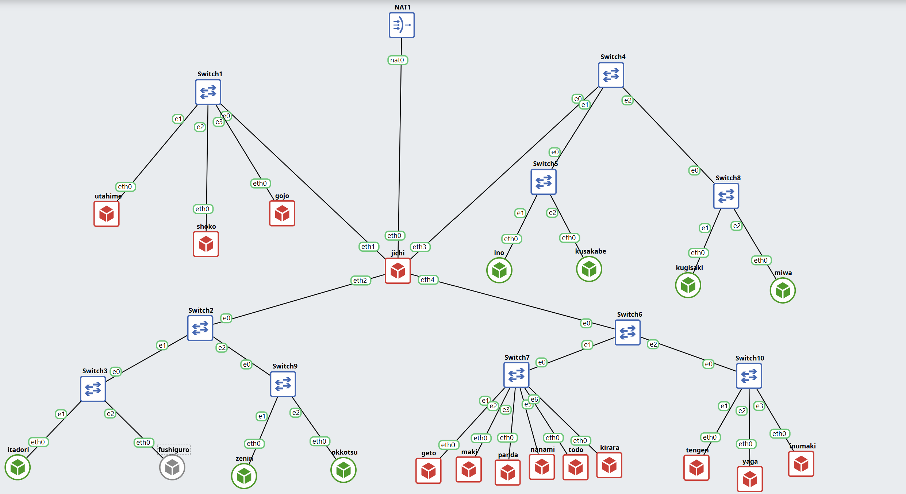

---

## Rancangan Pengalamatan IP

**Prefix kelompok: `10.86.x.x`**, domain kelompok: **`k45.com`**. jichi merentang ke 4 jaringan, tiap jaringan satu subnet `/24`.

| Network               | Subnet        | Gateway (di jichi) | Node di segmen ini                                       |
| --------------------- | ------------- | ------------------ | -------------------------------------------------------- |
| Network 1 (DMZ)       | 10.86.1.0/24  | 10.86.1.1 (eth1)   | utahime, shoko, gojo                                     |
| Network 2 (Divisi A)  | 10.86.2.0/24  | 10.86.2.1 (eth2)   | itadori, fushiguro, zenin, okkotsu (DHCP)                |
| Network 3 (Divisi B)  | 10.86.3.0/24  | 10.86.3.1 (eth3)   | ino, kusakabe, miwa, kugisaki (DHCP)                     |
| Network 4 (Data Center) | 10.86.4.0/24 | 10.86.4.1 (eth4)  | tengen, geto, maki, panda, nanami, todo, kirara, yaga, inumaki |

**Alamat IP node infrastruktur (statis):**

| Node    | IP           | Netmask       | Gateway   | Peran                      |
| ------- | ------------ | ------------- | --------- | -------------------------- |
| jichi   | multi eth    | 255.255.255.0 | -         | Router utama, NAT, DHCP Relay |
| utahime | 10.86.1.2    | 255.255.255.0 | 10.86.1.1 | DNS Master                 |
| shoko   | 10.86.1.3    | 255.255.255.0 | 10.86.1.1 | DNS Slave                  |
| gojo    | 10.86.1.4    | 255.255.255.0 | 10.86.1.1 | Public Reverse Proxy       |
| geto    | 10.86.4.2    | 255.255.255.0 | 10.86.4.1 | Internal Load Balancer     |
| maki    | 10.86.4.3    | 255.255.255.0 | 10.86.4.1 | Worker frontend            |
| panda   | 10.86.4.4    | 255.255.255.0 | 10.86.4.1 | Worker frontend            |
| nanami  | 10.86.4.5    | 255.255.255.0 | 10.86.4.1 | Worker API utama           |
| todo    | 10.86.4.6    | 255.255.255.0 | 10.86.4.1 | Worker API utama           |
| kirara  | 10.86.4.7    | 255.255.255.0 | 10.86.4.1 | Worker API cadangan        |
| yaga    | 10.86.4.8    | 255.255.255.0 | 10.86.4.1 | Database Master            |
| inumaki | 10.86.4.9    | 255.255.255.0 | 10.86.4.1 | Database Slave             |
| tengen  | 10.86.4.10   | 255.255.255.0 | 10.86.4.1 | DHCP Server                |

**Pemetaan interface di jichi:**

| Interface | Terhubung ke | IP                  |
| --------- | ------------ | ------------------- |
| eth0      | NAT1 (WAN)   | dhcp (192.168.122.x) |
| eth1      | Switch1      | 10.86.1.1           |
| eth2      | Switch2      | 10.86.2.1           |
| eth3      | Switch4      | 10.86.3.1           |
| eth4      | Switch6      | 10.86.4.1           |

**Kebijakan DHCP (rancangan akhir soal 4 sampai 6):**

| Client                 | Network | Rentang / alamat        | Lease time          |
| ---------------------- | ------- | ----------------------- | ------------------- |
| itadori, fushiguro     | 2       | 10.86.2.10 - 10.86.2.35 | 600 (default)       |
| zenin, okkotsu         | 2       | 10.86.2.70 - 10.86.2.95 | 600 (default)       |
| (tidak dialokasikan)   | 2       | 10.86.2.36 - 10.86.2.69 | -                   |
| ino, kusakabe          | 3       | 10.86.3.10 - 10.86.3.89 | **1800** (30 menit) |
| miwa                   | 3       | 10.86.3.100 - 10.86.3.199 | **43200** (12 jam) |
| kugisaki (VIP)         | 3       | **10.86.3.99** (fixed)  | 600 (default)       |


---

## Urutan Pengerjaan

1. **Start NAT1 dan semua switch.** 
2. **jichi** dikonfigurasi lebih dulu (WAN, gateway Network 1-4, forwarding, NAT), karena node lain butuh jalur keluar untuk mengunduh paket.
3. **Host infrastruktur** diberi IP statis, gateway, dan resolver awal.
4. **tengen** memasang `isc-dhcp-server`, **jichi** memasang `isc-dhcp-relay`, lalu **client** meminta lease.
5. Kebijakan alokasi diterapkan bertahap: 2 pool (soal 4), short/long lease dan DNS (soal 5), static lease (soal 6).
6. Validasi, capture paket, simulasi gangguan, dan uji restart (soal 7 sampai 10).

Verifikasi tiap tahap dilakukan sebelum lanjut ke tahap berikutnya.

---

### Soal 1 - Konektivitas dasar: gateway, forwarding, source NAT

**Diminta:** memulihkan konektivitas antarjaringan lewat jichi. eth0 memperoleh WAN dari NAT, eth1 sampai eth4 menjadi gateway Network 1 sampai 4. Mengaktifkan IPv4 forwarding dan source NAT, menetapkan IP statis host infrastruktur, lalu membuktikan konektivitas tiap host ke gateway dan akses eksternal.

**Persiapan:** pastikan **NAT1 dan semua switch sudah Start** (ikon biru).

#### Di jichi

Langkah 1, eth0 mendapat alamat dari DHCP NAT:

```sh
grep -q "iface eth0" /etc/network/interfaces || printf 'auto eth0\niface eth0 inet dhcp\n' >> /etc/network/interfaces
ip link set eth0 up
ifup eth0
ip -4 addr show eth0
```

Langkah 2, resolver awal supaya `apt` bisa mengunduh paket:

```sh
echo "nameserver 192.168.122.1" > /etc/resolv.conf
```

Langkah 3, alamat gateway tiap jaringan:

```sh
ip addr add 10.86.1.1/24 dev eth1 && ip link set eth1 up
ip addr add 10.86.2.1/24 dev eth2 && ip link set eth2 up
ip addr add 10.86.3.1/24 dev eth3 && ip link set eth3 up
ip addr add 10.86.4.1/24 dev eth4 && ip link set eth4 up
```

Langkah 4, IPv4 forwarding:

```sh
sysctl -w net.ipv4.ip_forward=1
```

Langkah 5, source NAT (masquerade) untuk seluruh subnet kelompok:

```sh
command -v iptables >/dev/null || (apt-get update && apt-get install -y iptables)
iptables -t nat -C POSTROUTING -s 10.86.0.0/16 -o eth0 -j MASQUERADE 2>/dev/null || \
iptables -t nat -A POSTROUTING -s 10.86.0.0/16 -o eth0 -j MASQUERADE
```

Penjelasan aturan `iptables`:

- `-t nat` : tabel NAT, untuk translasi alamat lalu lintas keluar
- `-A POSTROUTING` : berlaku pada paket yang akan meninggalkan router
- `-s 10.86.0.0/16` : hanya paket dari subnet internal kelompok
- `-o eth0` : keluar lewat eth0 (arah NAT)
- `-j MASQUERADE` : alamat sumber diganti alamat eth0 jichi

Langkah 6, semua langkah di atas disimpan sebagai `/root/net.sh` dan dipanggil dari `/root/.bashrc` supaya konfigurasi kembali setelah node di-restart (isi lengkap di `scripts/soal01.sh`):

```sh
sh /root/soal01.sh
```

#### Di host infrastruktur

Tabel nilai per node:

| Node    | IP         | Gateway   |
| ------- | ---------- | --------- |
| utahime | 10.86.1.2  | 10.86.1.1 |
| shoko   | 10.86.1.3  | 10.86.1.1 |
| gojo    | 10.86.1.4  | 10.86.1.1 |
| geto    | 10.86.4.2  | 10.86.4.1 |
| maki    | 10.86.4.3  | 10.86.4.1 |
| panda   | 10.86.4.4  | 10.86.4.1 |
| nanami  | 10.86.4.5  | 10.86.4.1 |
| todo    | 10.86.4.6  | 10.86.4.1 |
| kirara  | 10.86.4.7  | 10.86.4.1 |
| yaga    | 10.86.4.8  | 10.86.4.1 |
| inumaki | 10.86.4.9  | 10.86.4.1 |
| tengen  | 10.86.4.10 | 10.86.4.1 |

Contoh untuk `utahime` (ganti IP dan gateway sesuai tabel di tiap node):

```sh
ip addr add 10.86.1.2/24 dev eth0
ip link set eth0 up
ip route replace default via 10.86.1.1
echo "nameserver 192.168.122.1" > /etc/resolv.conf
```

Lalu simpan sebagai `/root/net.sh` (dikemas di `scripts/soal01.sh`, yang mengenali node dari hostname):

```sh
sh /root/soal01.sh
```

**Verifikasi:**

```sh
# di jichi
ip -br a
ip route
sysctl net.ipv4.ip_forward
iptables -t nat -L POSTROUTING -n -v
ping -c 2 8.8.8.8
ping -c 2 google.com

# di tiap host infrastruktur
ping -c 2 10.86.1.1        # utahime/shoko/gojo (Network 4: 10.86.4.1)
ping -c 2 8.8.8.8
ping -c 2 google.com

# cek massal dari jichi
for h in 1.2 1.3 1.4 4.2 4.3 4.4 4.5 4.6 4.7 4.8 4.9 4.10; do
  ping -c1 -W1 10.86.$h >/dev/null && echo "OK   10.86.$h" || echo "FAIL 10.86.$h"
done
```

**Hasil yang diharapkan jika berhasil:**

- `ip -br a` di jichi: eth0 memegang `192.168.122.x/24`, eth1 sampai eth4 memegang `10.86.1.1` sampai `10.86.4.1`, dan `ip route` memuat `default via 192.168.122.1 dev eth0`.
- `sysctl` menampilkan `net.ipv4.ip_forward = 1`.
- `iptables -t nat -L POSTROUTING -n -v` menampilkan **tepat satu** baris `MASQUERADE ... eth0 10.86.0.0/16`.
- Ping dari host infrastruktur ke gateway, `8.8.8.8`, dan `google.com` semuanya membalas. Setelah host melakukan ping keluar, counter `pkts` pada baris MASQUERADE di jichi **naik dari 0**, itu bukti NAT dipakai.
- Cek massal mencetak `OK` untuk ke-12 alamat.

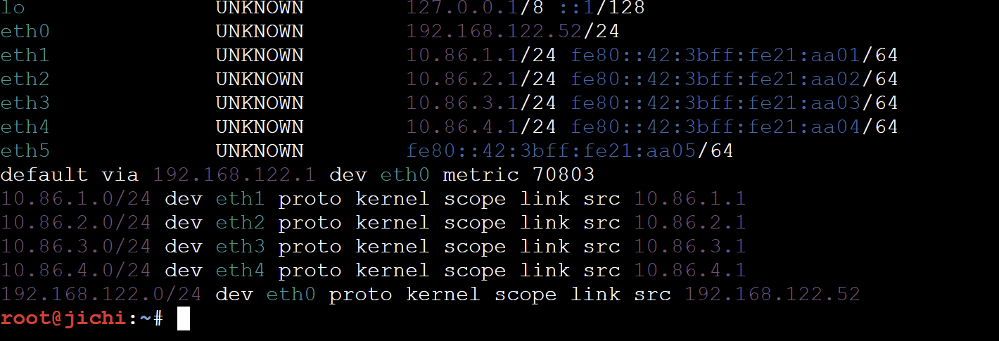
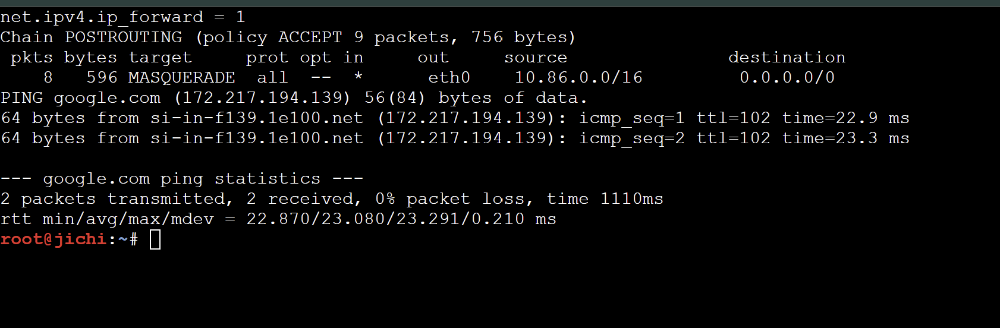
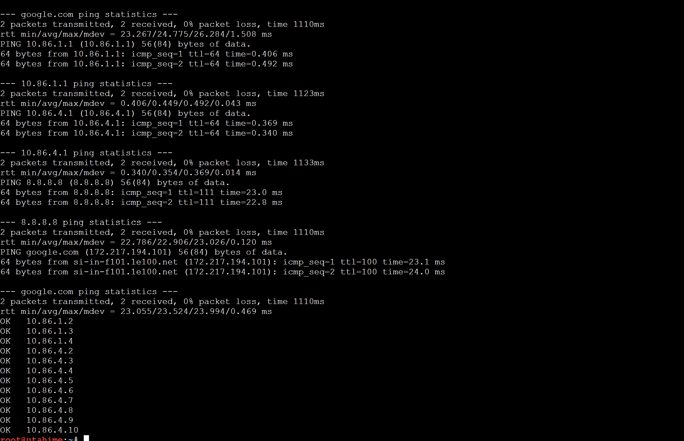
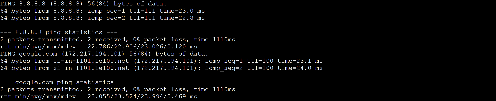

**Script:** `scripts/soal01.sh`, dijalankan di jichi dan 12 host infrastruktur.

---


### Soal 2 - DHCP Server di tengen

**Diminta:** mengonfigurasi `isc-dhcp-server` pada `10.86.4.10`. Network 4 dideklarasikan sebagai subnet lokal **tanpa pool dinamis**, lalu disiapkan scope DHCP untuk Network 2 dan Network 3. Konfigurasi divalidasi dan service aktif tanpa error `No subnet declaration`.

**Penjelasan:** dhcpd menolak start bila interface yang didengarkan (eth0 tengen, `10.86.4.10`) tidak punya `subnet` yang cocok. Karena itu Network 4 tetap dideklarasikan walau kosong. Scope Network 2 dan 3 di tahap ini masih **sementara**, dipecah di soal 4 dan 5.

**Di tengen**, pasang paket dan batasi DHCP hanya pada eth0:

```sh
apt-get update
DEBIAN_FRONTEND=noninteractive apt-get install -y isc-dhcp-server
sed -i 's/^INTERFACESv4=.*/INTERFACESv4="eth0"/' /etc/default/isc-dhcp-server
grep INTERFACESv4 /etc/default/isc-dhcp-server
```

Tulis konfigurasi (versi soal 2):

```sh
cat > /etc/dhcp/dhcpd.conf <<'EOF'
authoritative;
default-lease-time 600;
max-lease-time 7200;

# Network 4 (lokal tengen), tanpa pool dinamis
subnet 10.86.4.0 netmask 255.255.255.0 {
}

# Network 2 (Divisi A), sementara, dipecah jadi 2 pool di soal 4
subnet 10.86.2.0 netmask 255.255.255.0 {
    range 10.86.2.10 10.86.2.35;
    option routers 10.86.2.1;
    option subnet-mask 255.255.255.0;
    option broadcast-address 10.86.2.255;
    option domain-name-servers 192.168.122.1;
}

# Network 3 (Divisi B), sementara, dipecah jadi short/long lease di soal 5
subnet 10.86.3.0 netmask 255.255.255.0 {
    range 10.86.3.10 10.86.3.89;
    option routers 10.86.3.1;
    option subnet-mask 255.255.255.0;
    option broadcast-address 10.86.3.255;
    option domain-name-servers 192.168.122.1;
}
EOF
```

Validasi dan jalankan:

```sh
touch /var/lib/dhcp/dhcpd.leases
dhcpd -t -cf /etc/dhcp/dhcpd.conf
service isc-dhcp-server restart
service isc-dhcp-server status
ss -ulnp | grep ':67'
```

Bukti tidak ada error `No subnet declaration` (jalankan sebentar di foreground):

```sh
service isc-dhcp-server stop
timeout 3 dhcpd -4 -d -cf /etc/dhcp/dhcpd.conf eth0 2>&1 | grep -E "Listening|No subnet|Sending"
service isc-dhcp-server start
```

**Hasil yang diharapkan jika berhasil:**

- `dhcpd -t` hanya mencetak banner dan nama berkas, **tanpa pesan error**.
- Mode foreground menampilkan `Listening on LPF/eth0/<mac>/10.86.4.0/24` dan **tidak ada** `No subnet declaration for eth0`.
- `service isc-dhcp-server status` menyatakan service berjalan, dan `ss -ulnp` menunjukkan `dhcpd` mendengarkan UDP port `67`.

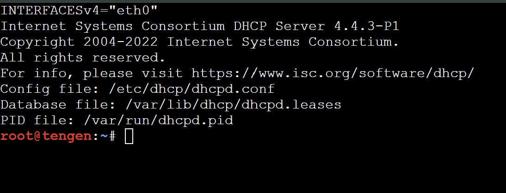
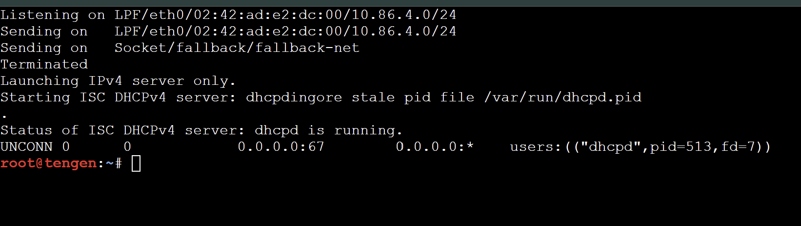

**Script:** `scripts/soal02.sh`, dijalankan di tengen.

---


### Soal 3 - DHCP Relay di jichi

**Diminta:** permintaan alamat Divisi A dan B tidak bisa menyeberangi subnet secara langsung, sehingga jichi dikonfigurasi sebagai DHCP Relay menuju `10.86.4.10` memakai eth2 (Network 2) dan eth3 (Network 3). Dibuktikan client kedua subnet memperoleh lease melalui relay.

**Penjelasan:** DHCPDISCOVER adalah broadcast dan router tidak meneruskan broadcast antar subnet. Relay menangkap broadcast dari eth2/eth3, mengirimnya **unicast** ke tengen dengan field `giaddr` berisi IP interface penerima, lalu mengembalikan balasan ke client. `giaddr` itu juga yang dipakai tengen untuk memilih `subnet` mana yang dilayani. eth4 ikut didaftarkan karena itu jalur menuju server.

**Di jichi:**

```sh
apt-get update
DEBIAN_FRONTEND=noninteractive apt-get install -y isc-dhcp-relay

cat > /etc/default/isc-dhcp-relay <<'EOF'
SERVERS="10.86.4.10"
INTERFACES="eth2 eth3 eth4"
OPTIONS=""
EOF

service isc-dhcp-relay restart
ps aux | grep [d]hcrelay
sysctl net.ipv4.ip_forward
```

**Di tiap client** (itadori, fushiguro, zenin, okkotsu, ino, kusakabe, miwa, kugisaki), set nama dan minta lease:

```sh
hostname itadori                     # sesuaikan nama node
ip link set eth0 up
ip addr flush dev eth0
udhcpc -i eth0 -n -q -t 3 -T 2
ip addr show dev eth0
ip route
```

Lalu persistenkan lewat `/root/net.sh` (`sh /root/soal03.sh`, dikenali dari hostname).

**Verifikasi di tengen:**

```sh
grep -E "^lease|hardware ethernet" /var/lib/dhcp/dhcpd.leases
```

**Hasil yang diharapkan jika berhasil:**

- Di jichi, `ps` menampilkan proses `dhcrelay` dengan interface `eth2 eth3 eth4` dan server `10.86.4.10`, forwarding bernilai `1`.
- Client Network 2 mendapat alamat `10.86.2.x` dengan default route `via 10.86.2.1`. Client Network 3 mendapat `10.86.3.x` dengan `via 10.86.3.1`. Baris `udhcpc` menyebut `lease of ... obtained from 10.86.4.10`.
- Di tengen, `dhcpd.leases` memuat entri `lease` beserta `hardware ethernet` tiap client.

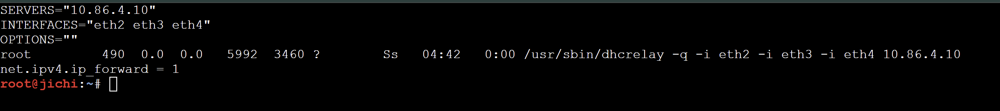
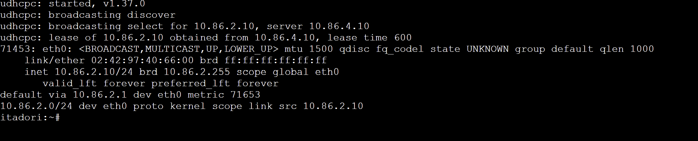
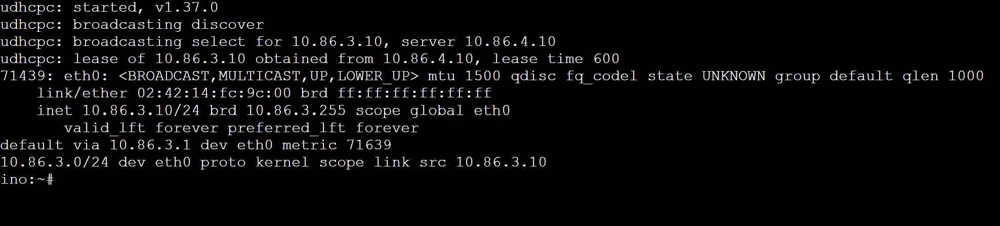
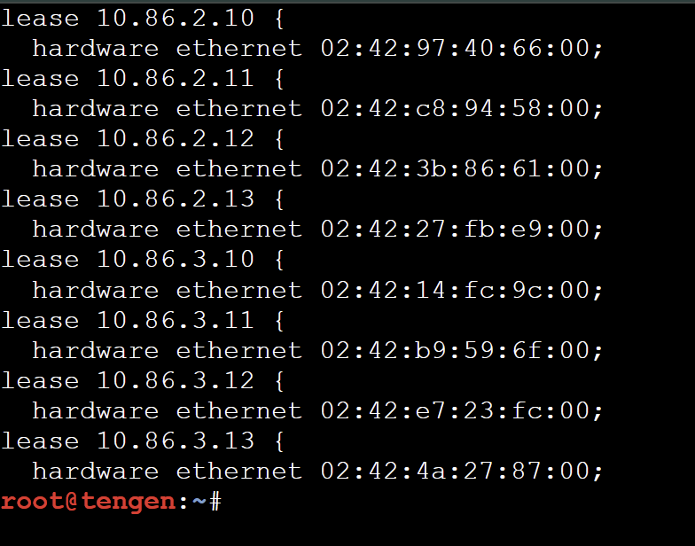

**Script:** `scripts/soal03.sh`, dijalankan di jichi (relay) dan 8 client.

---


### Soal 4 - Dua pool DHCP di Network 2

**Diminta:** dua pool pada Network 2. Pool 1 (`10.86.2.10` - `10.86.2.35`) untuk itadori dan fushiguro, Pool 2 (`10.86.2.70` - `10.86.2.95`) untuk zenin dan okkotsu. Rentang `10.86.2.36` - `10.86.2.69` tidak boleh dialokasikan. Pemisahan memakai DHCP class berdasarkan MAC Address atau Client ID.

**Penjelasan:** semua client satu subnet, jadi pemisahnya adalah identitas client. `match pick-first-value (option dhcp-client-identifier, hardware)` memakai Client ID bila ada, bila tidak memakai MAC. Tiap `pool` hanya menerima anggota class tertentu lewat `allow members of`. Rentang `.36` - `.69` aman karena tidak masuk `range` pool mana pun, dan client di luar class tidak mendapat apa-apa dari Network 2.

**Langkah 1, kumpulkan MAC client.** Di tiap client:

```sh
cat /sys/class/net/eth0/address
```

Di **tengen**, simpan ke `/root/macs.env` (dipakai ulang di soal 5 dan 6):

```sh
cat > /root/macs.env <<'EOF'
M_ITADORI=<mac itadori>
M_FUSHIGURO=<mac fushiguro>
M_ZENIN=<mac zenin>
M_OKKOTSU=<mac okkotsu>
M_INO=<mac ino>
M_KUSAKABE=<mac kusakabe>
M_MIWA=<mac miwa>
M_KUGISAKI=<mac kugisaki>
EOF
```

(ganti `<mac ...>` dengan MAC asli, format `02:42:ac:11:00:02`. `sh /root/soal04.sh mac` di tiap client mencetak barisnya langsung.)

**Langkah 2, di tengen:** reset lease lama (lease sementara dari soal 3 bisa tersangkut di pool yang salah), lalu tulis konfigurasi versi soal 4. Heredoc **tanpa kutip** supaya `$M_...` terisi dari `macs.env`:

```sh
service isc-dhcp-server stop
: > /var/lib/dhcp/dhcpd.leases
rm -f /var/lib/dhcp/dhcpd.leases~

. /root/macs.env
cat > /etc/dhcp/dhcpd.conf <<EOF
authoritative;
default-lease-time 600;
max-lease-time 7200;

# Class Divisi A, dipisah berdasarkan Client ID (fallback MAC)
class "divisi-a-pool1" {
    match pick-first-value (option dhcp-client-identifier, hardware);
}
subclass "divisi-a-pool1" 1:$M_ITADORI;
subclass "divisi-a-pool1" 1:$M_FUSHIGURO;

class "divisi-a-pool2" {
    match pick-first-value (option dhcp-client-identifier, hardware);
}
subclass "divisi-a-pool2" 1:$M_ZENIN;
subclass "divisi-a-pool2" 1:$M_OKKOTSU;

# Network 4 (lokal tengen), tanpa pool dinamis
subnet 10.86.4.0 netmask 255.255.255.0 {
}

# Network 2: dua pool
subnet 10.86.2.0 netmask 255.255.255.0 {
    option routers 10.86.2.1;
    option subnet-mask 255.255.255.0;
    option broadcast-address 10.86.2.255;
    option domain-name-servers 192.168.122.1;

    pool {
        allow members of "divisi-a-pool1";
        range 10.86.2.10 10.86.2.35;
    }
    pool {
        allow members of "divisi-a-pool2";
        range 10.86.2.70 10.86.2.95;
    }
}

# Network 3 (masih sementara, dipecah di soal 5)
subnet 10.86.3.0 netmask 255.255.255.0 {
    range 10.86.3.10 10.86.3.89;
    option routers 10.86.3.1;
    option subnet-mask 255.255.255.0;
    option broadcast-address 10.86.3.255;
    option domain-name-servers 192.168.122.1;
}
EOF

dhcpd -t -cf /etc/dhcp/dhcpd.conf
service isc-dhcp-server start
```

**Langkah 3, di itadori, fushiguro, zenin, okkotsu:** minta lease baru.

```sh
ip addr flush dev eth0
udhcpc -i eth0 -n -q
ip addr show dev eth0
ip route
```

**Langkah 4, di tengen:** rekap lease.

```sh
awk '/^lease/{ip=$2} /hardware ethernet/{gsub(";","",$3); print ip, $3}' /var/lib/dhcp/dhcpd.leases | sort -u
```

**Hasil yang diharapkan jika berhasil:**

- `itadori` dan `fushiguro` mendapat alamat di rentang `10.86.2.10` - `10.86.2.35`.
- `zenin` dan `okkotsu` mendapat alamat di rentang `10.86.2.70` - `10.86.2.95`.
- Gateway di keempatnya `10.86.2.1`.
- Rekap lease di tengen **tidak memuat satu pun alamat `10.86.2.36` - `10.86.2.69`**.

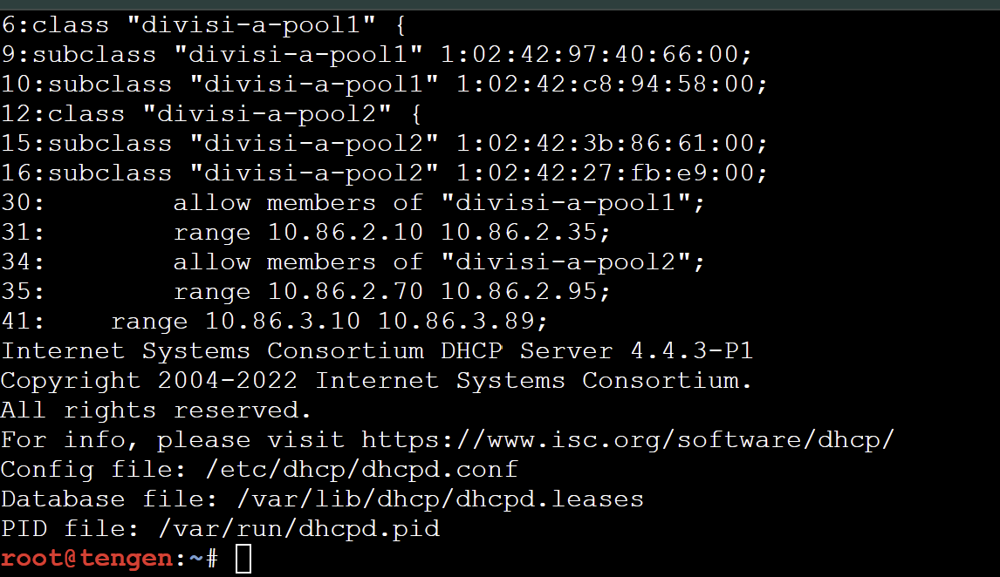
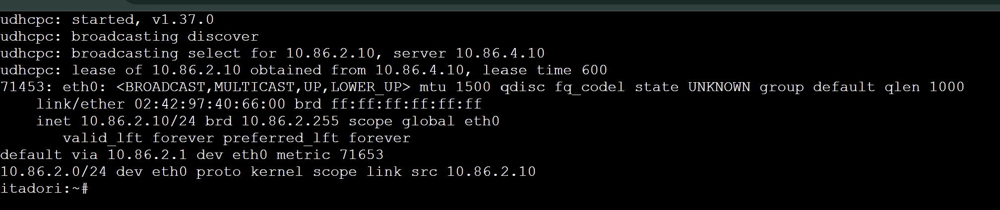
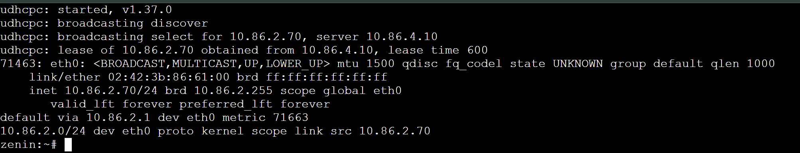
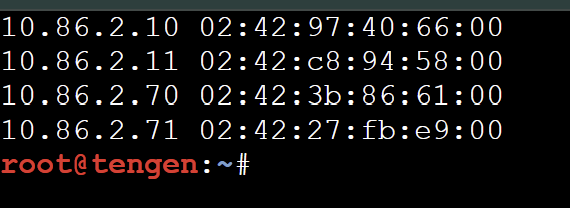

**Script:** `scripts/soal04.sh`. Di tengen untuk menerapkan, di client untuk `mac` dan `renew`.

---


### Soal 5 - Short lease, long lease, dan DHCP options di Network 3

**Diminta:** short lease 30 menit (1800 detik) untuk ino dan kusakabe, long lease 12 jam (43200 detik) untuk miwa. Pool short `10.86.3.10` - `10.86.3.89`, pool long `10.86.3.100` - `10.86.3.199`. `default-lease-time` dan `max-lease-time` disesuaikan per kelas. Opsi DHCP: DNS `10.86.1.2` dan `10.86.1.3`, serta domain-search `k45.com`.

**Penjelasan:** lease time ditaruh **di dalam tiap `pool`**, sehingga otomatis mengikuti class yang boleh masuk pool itu. `max-lease-time` sengaja **sama dengan** `default-lease-time` agar durasi persis 1800 dan 43200 walau client meminta lebih lama. Opsi DNS dan domain ditaruh **global** karena soal 7 mewajibkannya juga untuk Network 2. Alamat `.90` - `.99` tidak masuk pool mana pun, jadi `.3.99` aman untuk fixed address kugisaki di soal 6.

**Di tengen:** reset lease, lalu tulis konfigurasi versi soal 5:

```sh
service isc-dhcp-server stop
: > /var/lib/dhcp/dhcpd.leases
rm -f /var/lib/dhcp/dhcpd.leases~

. /root/macs.env
cat > /etc/dhcp/dhcpd.conf <<EOF
authoritative;
default-lease-time 600;
max-lease-time 7200;

# DNS dan domain untuk semua client (Network 2 dan 3)
option domain-name-servers 10.86.1.2, 10.86.1.3;
option domain-name "k45.com";
option domain-search "k45.com";

# Class Divisi A, dipisah berdasarkan Client ID (fallback MAC)
class "divisi-a-pool1" {
    match pick-first-value (option dhcp-client-identifier, hardware);
}
subclass "divisi-a-pool1" 1:$M_ITADORI;
subclass "divisi-a-pool1" 1:$M_FUSHIGURO;

class "divisi-a-pool2" {
    match pick-first-value (option dhcp-client-identifier, hardware);
}
subclass "divisi-a-pool2" 1:$M_ZENIN;
subclass "divisi-a-pool2" 1:$M_OKKOTSU;

# Class Divisi B
class "short-lease" {
    match pick-first-value (option dhcp-client-identifier, hardware);
}
subclass "short-lease" 1:$M_INO;
subclass "short-lease" 1:$M_KUSAKABE;

class "long-lease" {
    match pick-first-value (option dhcp-client-identifier, hardware);
}
subclass "long-lease" 1:$M_MIWA;

# Network 4 (lokal tengen), tanpa pool dinamis
subnet 10.86.4.0 netmask 255.255.255.0 {
}

# Network 2: dua pool
subnet 10.86.2.0 netmask 255.255.255.0 {
    option routers 10.86.2.1;
    option subnet-mask 255.255.255.0;
    option broadcast-address 10.86.2.255;

    pool {
        allow members of "divisi-a-pool1";
        range 10.86.2.10 10.86.2.35;
    }
    pool {
        allow members of "divisi-a-pool2";
        range 10.86.2.70 10.86.2.95;
    }
}

# Network 3: short lease dan long lease
subnet 10.86.3.0 netmask 255.255.255.0 {
    option routers 10.86.3.1;
    option subnet-mask 255.255.255.0;
    option broadcast-address 10.86.3.255;

    pool {
        allow members of "short-lease";
        range 10.86.3.10 10.86.3.89;
        default-lease-time 1800;
        max-lease-time 1800;
    }
    pool {
        allow members of "long-lease";
        range 10.86.3.100 10.86.3.199;
        default-lease-time 43200;
        max-lease-time 43200;
    }
}
EOF

dhcpd -t -cf /etc/dhcp/dhcpd.conf
service isc-dhcp-server start
```

**Di ino, kusakabe, miwa:**

```sh
ip addr flush dev eth0
udhcpc -i eth0 -n -q          # baca baris "lease of ... lease time ..."
ip addr show dev eth0
ip route
cat /etc/resolv.conf
```

Cek Network 2 tidak rusak (di itadori dan zenin):

```sh
ip addr flush dev eth0 && udhcpc -i eth0 -n -q && ip addr show dev eth0
```

**Hasil yang diharapkan jika berhasil:**

| Client             | Alamat                    | Lease time pada baris `udhcpc` |
| ------------------ | ------------------------- | ------------------------------ |
| ino, kusakabe      | `10.86.3.10` - `10.86.3.89`   | `1800`                     |
| miwa               | `10.86.3.100` - `10.86.3.199` | `43200`                    |

- Gateway `10.86.3.1`, dan `resolv.conf` berisi `nameserver 10.86.1.2`, `nameserver 10.86.1.3`, serta `search k45.com`.
- `kugisaki` **belum mendapat alamat** pada tahap ini (belum masuk class mana pun). Itu sesuai rancangan, diselesaikan di soal 6.
- DNS `10.86.1.2` dan `10.86.1.3` baru dibangun pada soal DNS berikutnya, jadi resolusi nama dari client belum berfungsi, tetapi `ping 8.8.8.8` tetap bisa. Itu **bukan bug**.

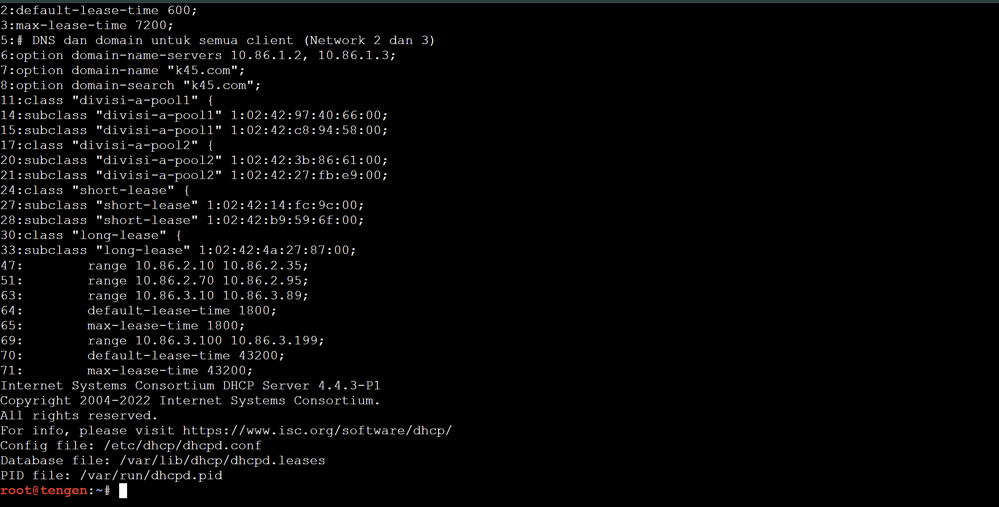
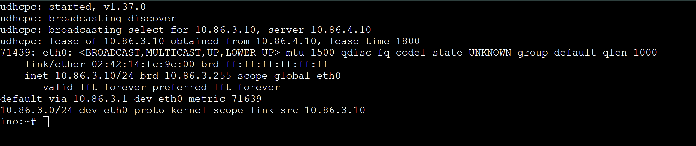
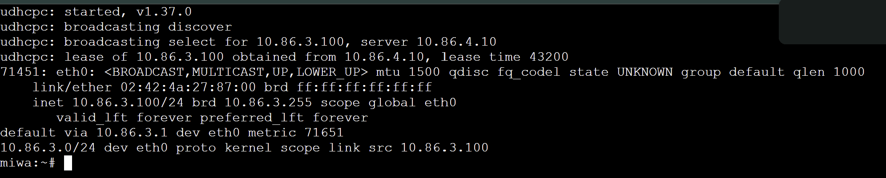
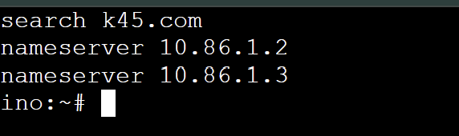

**Script:** `scripts/soal05.sh`. Di tengen untuk menerapkan, di client untuk `renew`.

---


### Soal 6 - Static lease untuk kugisaki

**Diminta:** kugisaki (personel VIP) selalu mendapat alamat yang sama. Dibuat DHCP static lease berdasarkan MAC dengan fixed address `10.86.3.99` di luar seluruh pool dinamis, konfigurasi divalidasi, lease di-renew di client, dan dibuktikan alamat yang diterima sesuai reservasi.

**Penjelasan:** blok `host` dengan `hardware ethernet` dan `fixed-address` memetakan satu MAC ke satu alamat tetap. Alamat `10.86.3.99` berada di celah `.90` - `.99` yang tidak masuk pool short maupun long, sehingga tidak bisa diberikan ke client lain.

**Di tengen:** tulis konfigurasi versi soal 6 (soal 5 ditambah blok `host`). Lease **tidak** di-reset di tahap ini:

```sh
service isc-dhcp-server stop
. /root/macs.env
cat > /etc/dhcp/dhcpd.conf <<EOF
authoritative;
default-lease-time 600;
max-lease-time 7200;

# DNS dan domain untuk semua client (Network 2 dan 3)
option domain-name-servers 10.86.1.2, 10.86.1.3;
option domain-name "k45.com";
option domain-search "k45.com";

# Class Divisi A, dipisah berdasarkan Client ID (fallback MAC)
class "divisi-a-pool1" {
    match pick-first-value (option dhcp-client-identifier, hardware);
}
subclass "divisi-a-pool1" 1:$M_ITADORI;
subclass "divisi-a-pool1" 1:$M_FUSHIGURO;

class "divisi-a-pool2" {
    match pick-first-value (option dhcp-client-identifier, hardware);
}
subclass "divisi-a-pool2" 1:$M_ZENIN;
subclass "divisi-a-pool2" 1:$M_OKKOTSU;

# Class Divisi B
class "short-lease" {
    match pick-first-value (option dhcp-client-identifier, hardware);
}
subclass "short-lease" 1:$M_INO;
subclass "short-lease" 1:$M_KUSAKABE;

class "long-lease" {
    match pick-first-value (option dhcp-client-identifier, hardware);
}
subclass "long-lease" 1:$M_MIWA;

# Network 4 (lokal tengen), tanpa pool dinamis
subnet 10.86.4.0 netmask 255.255.255.0 {
}

# Network 2: dua pool
subnet 10.86.2.0 netmask 255.255.255.0 {
    option routers 10.86.2.1;
    option subnet-mask 255.255.255.0;
    option broadcast-address 10.86.2.255;

    pool {
        allow members of "divisi-a-pool1";
        range 10.86.2.10 10.86.2.35;
    }
    pool {
        allow members of "divisi-a-pool2";
        range 10.86.2.70 10.86.2.95;
    }
}

# Network 3: short lease dan long lease
subnet 10.86.3.0 netmask 255.255.255.0 {
    option routers 10.86.3.1;
    option subnet-mask 255.255.255.0;
    option broadcast-address 10.86.3.255;

    pool {
        allow members of "short-lease";
        range 10.86.3.10 10.86.3.89;
        default-lease-time 1800;
        max-lease-time 1800;
    }
    pool {
        allow members of "long-lease";
        range 10.86.3.100 10.86.3.199;
        default-lease-time 43200;
        max-lease-time 43200;
    }
}

# Static lease kugisaki (VIP), di luar semua pool
host kugisaki {
    hardware ethernet $M_KUGISAKI;
    fixed-address 10.86.3.99;
}
EOF

dhcpd -t -cf /etc/dhcp/dhcpd.conf
service isc-dhcp-server start
```

**Di kugisaki:** renew lease.

```sh
ip addr flush dev eth0
udhcpc -i eth0 -n -q
ip addr show dev eth0
ip route
```

**Hasil yang diharapkan jika berhasil:**

- `dhcpd -t` bersih tanpa error.
- kugisaki mendapat **`10.86.3.99`**, gateway `10.86.3.1`, berapa kali pun di-renew.
- **Penting:** `kugisaki` **tidak akan muncul di `/var/lib/dhcp/dhcpd.leases`**. Itu perilaku normal ISC dhcpd, host reservasi dengan `fixed-address` tidak disimpan sebagai lease dinamis. Pembuktiannya dari sisi client (`ip addr`), dan nanti dari capture soal 8 (`Your-IP 10.86.3.99`).

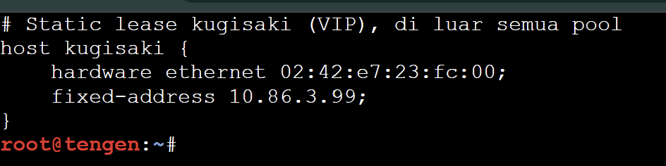
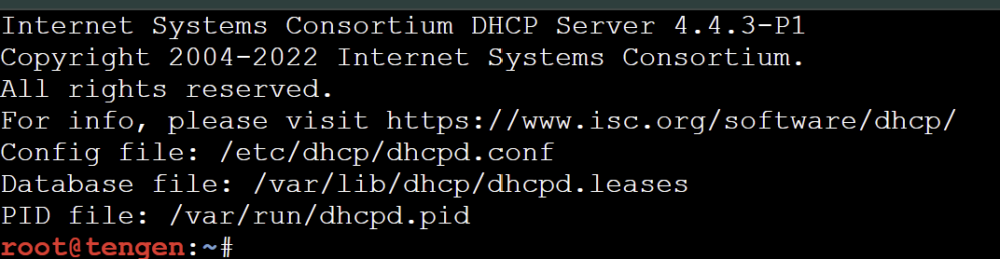
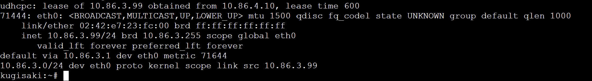

**Script:** `scripts/soal06.sh`. Di tengen untuk menerapkan, di kugisaki untuk `renew`.

---


### Soal 7 - Validasi konfigurasi client dan lease

**Diminta:** memastikan setiap client menerima konfigurasi sesuai wilayahnya: netmask `255.255.255.0` (/24), gateway dan broadcast yang benar, DNS `10.86.1.2` dan `10.86.1.3`, serta domain-search yang ditentukan. IP address dan routing client Divisi A dan B diperiksa, lalu lease dicocokkan dengan `/var/lib/dhcp/dhcpd.leases` di tengen. Tidak boleh ada alamat yang bertabrakan atau di luar kebijakan pool.

**Di tiap client (8 node)**, pastikan lease baru, lalu periksa:

```sh
ip addr flush dev eth0 && udhcpc -i eth0 -n -q
ip addr show dev eth0
ip route
cat /etc/resolv.conf
```

Tabel nilai yang benar:

| Network | Netmask / prefix  | Gateway   | Broadcast    | DNS                    | Domain-search |
| ------- | ----------------- | --------- | ------------ | ---------------------- | ------------- |
| 2       | 255.255.255.0 /24 | 10.86.2.1 | 10.86.2.255  | 10.86.1.2, 10.86.1.3   | k45.com       |
| 3       | 255.255.255.0 /24 | 10.86.3.1 | 10.86.3.255  | 10.86.1.2, 10.86.1.3   | k45.com       |

**Di tengen**, cocokkan lease:

```sh
grep -E "^lease|starts|ends|hardware ethernet" /var/lib/dhcp/dhcpd.leases
```

Script `soal07.sh` mengotomatiskan seluruh pemeriksaan di atas. Di client mencetak `OK` atau `FAIL` per item. Di tengen mencocokkan tiap lease aktif dengan kebijakan (pool, lease time) lalu menyimpulkan.

**Hasil yang diharapkan jika berhasil:**

- Di tiap client, semua item `OK`: `network`, `netmask (/)`, `broadcast`, `gateway`, `dns`, `domain-search`.
- Di tengen, tabel lease menunjukkan `OK` di setiap baris, misalnya `ino ... lease=1800 OK`, `miwa ... lease=43200 OK`, dan penutup `HASIL: semua lease sesuai kebijakan (pool, lease time, fixed address)`.
- Tidak ada alamat `10.86.2.36` - `10.86.2.69` maupun `10.86.3.90` - `10.86.3.98`, dan tiap alamat hanya dipegang satu client (dhcpd tidak pernah memberi satu alamat ke dua client aktif).
- `kugisaki` tidak ada di tabel server (lihat catatan soal 6), buktikan lewat `soal07.sh` di kugisaki yang harus `OK` dengan `10.86.3.99`.

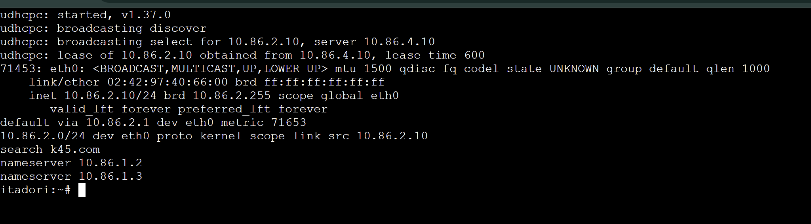
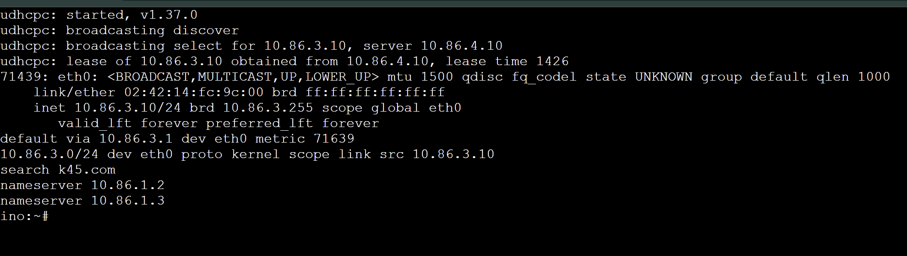
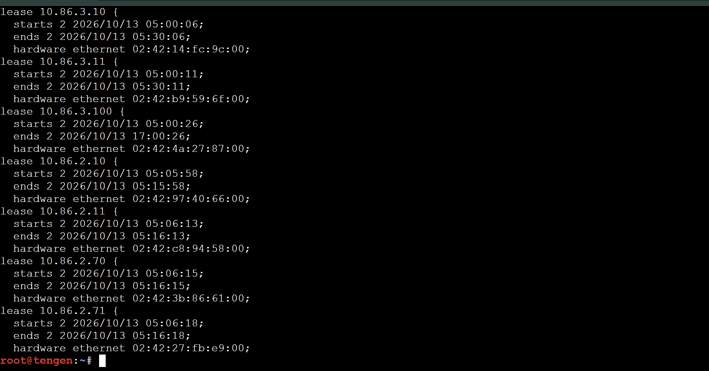

**Script:** `scripts/soal07.sh`. Jalankan di client dulu, baru di tengen.

---


### Soal 8 - Packet capture proses DHCP (DORA)

**Diminta:** membuktikan proses pemberian alamat sesuai protokol. Dilakukan packet capture saat salah satu client Network 2 atau 3 meminta lease baru, memakai `tcpdump` di tengen, untuk menunjukkan urutan DHCPDISCOVER, DHCPOFFER, DHCPREQUEST, DHCPACK. Diidentifikasi alamat server, alamat yang diberikan, lease time, dan field `giaddr`, yang harus sesuai interface jichi yang menerima request.

**Di tengen:** pasang tcpdump dan mulai capture (40 detik):

```sh
apt-get install -y tcpdump
timeout 40 tcpdump -ni eth0 -s0 -U -w /root/soal08-dora.pcap 'udp port 67 or udp port 68'
```

**Selama capture berjalan, di itadori (Network 2) atau ino (Network 3):**

```sh
ip addr flush dev eth0
udhcpc -i eth0 -n -q
```

**Di tengen, baca hasilnya:**

```sh
tcpdump -nvvv -r /root/soal08-dora.pcap | grep -E "BOOTP/DHCP|Gateway-IP|Your-IP|Client-Ethernet|DHCP-Message|Server-ID|Lease-Time|Requested-IP"
tcpdump -nvvv -r /root/soal08-dora.pcap | grep Gateway-IP | sort -u
```

**Hasil yang diharapkan jika berhasil:**

| Pesan DHCP | Terlihat sebagai                                              | Yang diidentifikasi |
| ---------- | ------------------------------------------------------------- | ------------------- |
| Discover   | unicast jichi ke `10.86.4.10.67`, `DHCP-Message ... Discover` | `Gateway-IP` = giaddr |
| Offer      | `10.86.4.10.67` ke giaddr (misalnya `10.86.2.1.67`), `Offer`  | `Your-IP` = alamat yang ditawarkan, `Server-ID 10.86.4.10`, `Lease-Time` |
| Request    | unicast jichi ke `10.86.4.10.67`, `Request`                   | `Requested-IP`, `Server-ID`, `Gateway-IP` |
| ACK        | `10.86.4.10.67` ke giaddr, `ACK`                              | `Your-IP`, `Lease-Time` final |

- **Alamat server** = `Server-ID 10.86.4.10` (tengen).
- **Alamat yang diberikan** = `Your-IP`, misalnya `10.86.2.10` untuk itadori.
- **Lease time** = `Lease-Time`, misalnya `600` untuk Network 2, `1800` untuk ino.
- **giaddr** = `Gateway-IP`: bernilai **`10.86.2.1`** bila client dari Network 2 (eth2 jichi), dan **`10.86.3.1`** bila dari Network 3 (eth3 jichi).
- Paket yang terlihat di tengen adalah **unicast antara relay dan server**, bukan broadcast asli client. Itu bukti relay bekerja.
- Bila client yang dicoba adalah kugisaki, `Your-IP` bernilai `10.86.3.99`, sekaligus bukti static lease soal 6.

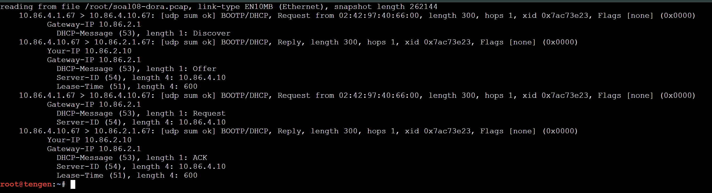
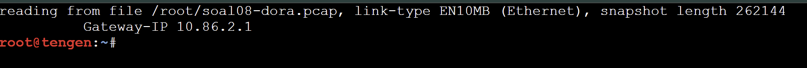

**Script:** `scripts/soal08.sh`. Jalankan di tengen dulu, pindah ke client dalam 40 detik.

---


### Soal 9 - Simulasi gangguan DHCP Relay dan pemulihan

**Diminta:** menghentikan service DHCP Relay di jichi, memaksa salah satu client Network 2 atau 3 meminta lease baru dan mencatat gejalanya, memulihkan relay, mengulangi permintaan, lalu membuktikan client kembali mendapat alamat dari pool yang benar dengan gateway semula.

**Langkah 1, di jichi:** hentikan relay.

```sh
service isc-dhcp-relay stop
ps aux | grep [d]hcrelay
```

**Langkah 2, di client (contoh zenin):** minta lease baru dan catat gejalanya.

```sh
ip addr flush dev eth0
udhcpc -i eth0 -n -q -t 3 -T 2
ip addr show dev eth0
ip route
```

(Opsional, di tengen: `timeout 15 tcpdump -ni eth0 'udp port 67 or udp port 68'` sambil client meminta lease, untuk membuktikan tidak ada paket yang sampai.)

**Langkah 3, di jichi:** pulihkan relay.

```sh
service isc-dhcp-relay restart
ps aux | grep [d]hcrelay
```

**Langkah 4, di client yang sama:** ulangi permintaan.

```sh
ip addr flush dev eth0
udhcpc -i eth0 -n -q
ip addr show dev eth0
ip route
```

**Hasil yang diharapkan jika berhasil:**

- **Saat relay mati (gejala gangguan):** `udhcpc` mengirim beberapa `sending discover` lalu berakhir `no lease, failing`. Client **tidak punya alamat IPv4** dan **tidak punya default route**. Bila diamati di tengen, tidak ada paket DHCP yang sampai.
- **Setelah relay pulih:** `udhcpc` mencetak `lease of 10.86.x.y obtained from 10.86.4.10`. Alamat berada di **pool yang benar** untuk client itu (misalnya zenin di `10.86.2.70` - `10.86.2.95`), dengan default route **`via 10.86.2.1`** seperti semula.

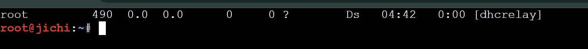
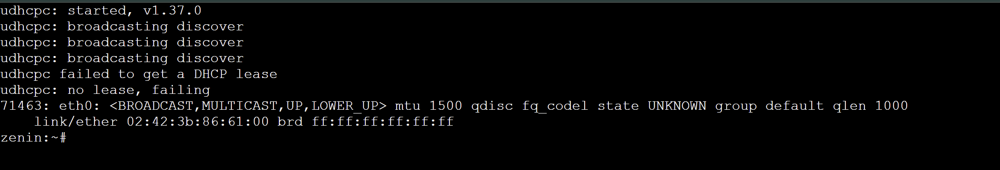
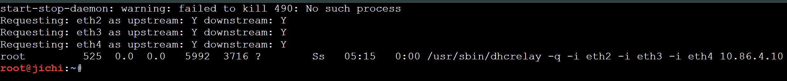


**Script:** `scripts/soal09.sh`. `stop` dan `start` di jichi, tanpa argumen di client, `watch` di tengen (opsional).

---


### Soal 10 - Autostart dan ketahanan setelah restart

**Diminta:** mengaktifkan autostart DHCP Server di tengen dan DHCP Relay di jichi, merestart kedua node, lalu memverifikasi status layanan, IP, gateway, lease, dan konektivitas client Network 2 dan 3. Kebijakan Pool 1, Pool 2, short lease, long lease, dan fixed address harus tetap berlaku.

**Penjelasan:** container GNS3 tidak menjalankan init lengkap, jadi `update-rc.d` saja tidak cukup untuk menyalakan service saat node nyala. Autostart dipasang **dua lapis**: `update-rc.d` (agar terdaftar) dan baris `service ... start` di `/root/.bashrc` (yang benar-benar menyalakan service saat console node dibuka, sesudah `/root/net.sh` memulihkan IP).

**Di tengen:**

```sh
update-rc.d isc-dhcp-server defaults
update-rc.d isc-dhcp-server enable
grep -q "isc-dhcp-server start" /root/.bashrc || echo 'service isc-dhcp-server start >/dev/null 2>&1' >> /root/.bashrc
```

**Di jichi:**

```sh
update-rc.d isc-dhcp-relay defaults
update-rc.d isc-dhcp-relay enable
grep -q "isc-dhcp-relay start" /root/.bashrc || echo 'service isc-dhcp-relay start >/dev/null 2>&1' >> /root/.bashrc
```

**Restart:** di GNS3 Stop lalu Start **jichi dan tengen**. Setelah menyala, **buka console masing-masing** (urutan jichi, lalu tengen, lalu client) supaya `/root/.bashrc` berjalan.

**Verifikasi setelah restart:**

```sh
# di tengen
ip -br a
ip route
service isc-dhcp-server status
ss -ulnp | grep ':67'

# di jichi
ip -br a
ip route
sysctl net.ipv4.ip_forward
iptables -t nat -L POSTROUTING -n -v
service isc-dhcp-relay status

# di client Network 2 dan 3
ip addr flush dev eth0 && udhcpc -i eth0 -n -q
ip addr show dev eth0
ip route
```

Lalu validasi ulang kebijakan: `sh /root/soal07.sh` di client, kemudian di tengen.

**Hasil yang diharapkan jika berhasil:**

- tengen: IP `10.86.4.10` dan default route `via 10.86.4.1` kembali, `isc-dhcp-server` berjalan, UDP `67` terbuka, lease lama masih tersimpan di `dhcpd.leases`.
- jichi: eth0 dapat `192.168.122.x`, eth1 sampai eth4 `10.86.x.1`, forwarding `= 1`, **satu** rule MASQUERADE, dan proses `dhcrelay` berjalan.
- Client Network 2 dan 3 mendapat lease **tanpa campur tangan manual**, dengan kebijakan yang sama seperti sebelum restart: itadori dan fushiguro di `.2.10-.35`, zenin dan okkotsu di `.2.70-.95`, ino dan kusakabe lease `1800`, miwa lease `43200`, kugisaki `10.86.3.99`.
- `soal07.sh` tetap menampilkan semua `OK`.

> **Catatan jujur:** autostart bergantung pada console dibuka, karena container tidak punya init penuh. Bila ingin nyala tanpa membuka console, bisa memakai baris `up` pada Edit config node di GNS3, tetapi pada laporan ini yang dipakai adalah hook `.bashrc` yang sama dengan skrip Modul 3.

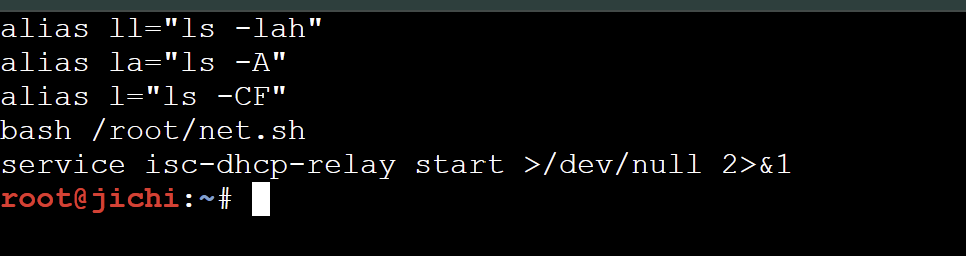
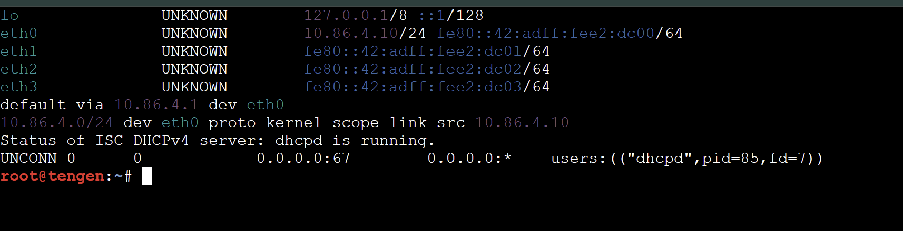
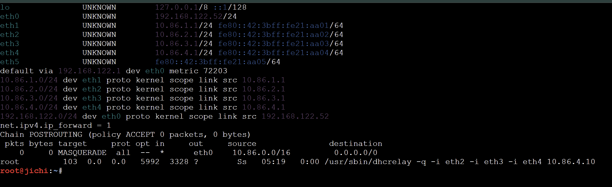
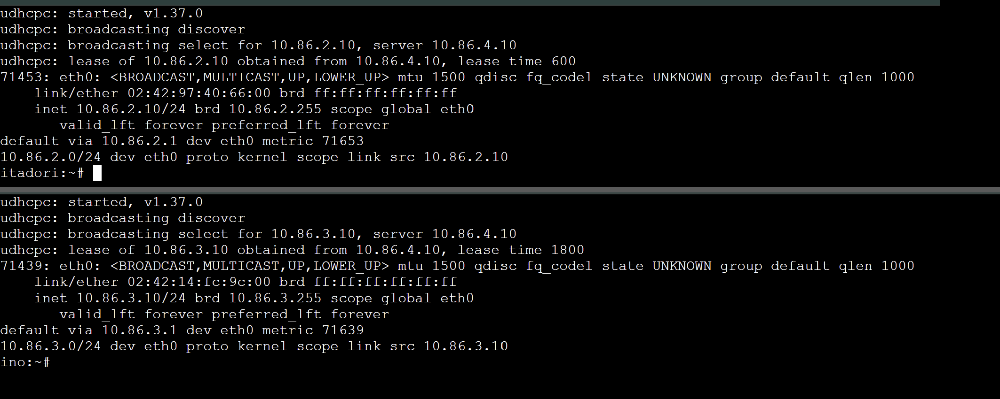

**Script:** `scripts/soal10.sh`. Tanpa argumen untuk mengaktifkan, `check` untuk verifikasi setelah restart.

---

## Troubleshooting

Urutan periksa dari modul: **interface, IP/subnet, gateway/routing, DHCP server, DHCP relay, DHCP client**.

| Gejala | Penyebab dan perbaikan |
| ------ | ---------------------- |
| `Destination Host Unreachable` dari IP node sendiri ke gateway | ARP tidak dijawab. **Switch atau NAT1 belum Start (ikon abu-abu)**, atau kabel salah port. Start semua switch, tarik ulang kabel (ujung node harus `eth0`). Bila node NAT1 "diam" padahal hidup, hapus dan buat ulang NAT1 |
| `jichi` eth0 tanpa IP, `Network is unreachable` | NAT1 belum Start atau kabel `nat0` bukan ke eth0. `ping 192.168.122.1` harus balas |
| Ping `8.8.8.8` gagal dari host, tapi gateway OK | Forwarding atau MASQUERADE di jichi hilang (hilang tiap restart). Jalankan ulang `sh /root/soal01.sh` di jichi |
| `ping google.com` gagal, `8.8.8.8` OK | `/etc/resolv.conf` belum `nameserver 192.168.122.1` |
| Client tidak dapat IP | `service isc-dhcp-relay status` di jichi, `service isc-dhcp-server status` di tengen, lalu `tcpdump -ni eth0 'port 67 or port 68'` di tengen. Discover tidak sampai = masalah relay/routing. Discover sampai tanpa Offer = masalah `dhcpd.conf` (class/pool) |
| `dhcpd` gagal start | `dhcpd -t -cf /etc/dhcp/dhcpd.conf`, lalu foreground `dhcpd -4 -d -cf /etc/dhcp/dhcpd.conf eth0` |
| `No subnet declaration for eth0` | Network 4 belum dideklarasikan, atau `INTERFACESv4` salah |
| Client dapat IP dari pool salah | Lease lama tersangkut. Stop server, `: > /var/lib/dhcp/dhcpd.leases`, start, lalu `ip addr flush dev eth0` di client sebelum `udhcpc` |
| `subclass ... 1:;` kosong | `/root/macs.env` belum terisi, atau lupa `. /root/macs.env` |
| kugisaki tidak ada di `dhcpd.leases` | Normal untuk `fixed-address`. Buktikan dari client |
| IP hilang setelah restart node | Buka console node supaya `/root/.bashrc` menjalankan `/root/net.sh` |
